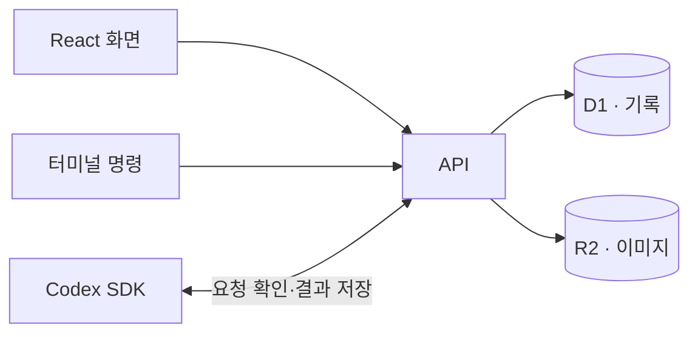

# Synapse

공부하면서 적어둔 메모들을 개념별로 연결해서 보려고 만든 웹앱입니다.

예를 들어 Kubernetes를 공부했다면 Pod와 Deployment는 그 안의 용어로 정리하고, Docker나 가상머신은 따로 연결해둘 수 있습니다. Redis와 PostgreSQL처럼 차이가 궁금한 개념은 비교표로 정리합니다. 나중에 다시 읽었을 때 어떤 관계인지 떠올릴 수 있게 만드는 게 목적입니다.

[사이트](https://atlas-knowledge-garden-m8q4.wandering1717.chatgpt.site) · [학습 내용](backups/2026-11-09/README.md) · [CLI 사용법](CLI_README.md)

## 기록하는 방식

지도에서 개념을 누르면 그동안 적은 메모와 용어가 보입니다. 메모는 날짜순으로 쌓이고, 마크다운과 이미지를 넣을 수 있습니다. 이름이나 영문 약칭으로 검색해도 같은 내용을 찾을 수 있습니다.

분류가 바로 떠오르지 않으면 빠른 기록으로 먼저 저장해두고 나중에 옮기면 됩니다. 개념을 합치거나 상하위 관계를 추가할 수도 있습니다. 비교표는 직접 작성하거나 마크다운 표를 가져와 만들 수 있습니다.

중요한 부분에는 형광펜 표시를 해두고 다시 볼 수 있습니다. 날짜별로 얼마나 기록했는지는 학습 기록의 잔디에 표시됩니다.

## 실행

Node.js 24 이상, npm, `zip`이 필요합니다.

```bash
git clone https://github.com/AAISSJ/synapse.git
cd synapse
npm ci
npm run build
npm run dev
```

<http://127.0.0.1:4173>에서 확인할 수 있습니다. 로컬에서는 개발용 계정으로 바로 들어가고, 기록과 이미지는 `.sites-runtime/`에 저장됩니다. 운영 사이트와는 별개의 데이터입니다.

코드를 수정했다면 `npm run build`를 다시 실행하고 개발 서버를 재시작하면 됩니다. 테스트는 `npm test`, DB 스키마를 바꾼 뒤 마이그레이션을 만드는 명령은 `npm run db:generate`입니다.

## 구조

화면은 React로 만들었고 API는 Cloudflare Workers에서 실행됩니다. 기록은 D1에, 이미지 파일은 R2에 저장합니다. 현재 배포에는 Sites를 사용하고 있습니다.



키워드로 개념을 만들거나 메모를 요약하는 기능에는 Codex SDK를 씁니다. 이 기능을 사용하려면 Codex에 로그인한 환경에서 `npm run worker`를 따로 실행해둬야 합니다. 설정 방법은 [CLI 사용법](CLI_README.md)에 있습니다.

GitHub 로그인을 설정하려면 OAuth App에서 Device Flow를 켜고, 운영 환경의 `GITHUB_CLIENT_ID`에 Client ID를 넣습니다. 기존 ChatGPT 계정의 기록을 이어 쓰려면 로그인한 상태에서 GitHub 계정을 먼저 연결하면 됩니다.

```text
client/       화면과 그래프
server/       API, 로그인, 데이터 저장
worker/       Cloudflare에서 웹 요청을 받는 코드
db/           DB 스키마
drizzle/      DB 마이그레이션
shared/       화면과 서버가 함께 쓰는 로직
cli/          터미널 명령과 Codex SDK 연동
tests/        테스트
backups/      학습 내용과 이미지 백업
```

배포 설정은 [.openai/hosting.json](.openai/hosting.json)에 있습니다. API 명세는 `/api/v1/openapi.json`에서 볼 수 있습니다.
