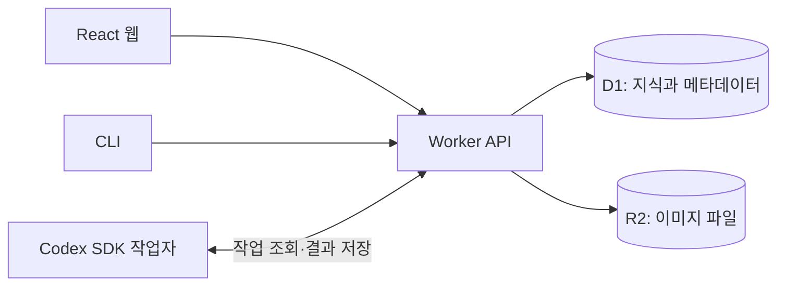

# Synapse

공부한 개념과 메모를 그래프로 연결해 정리하는 웹앱입니다. 개념마다 용어·기록·이미지를 쌓고, 비슷한 개념은 비교표로 정리합니다.

[서비스 열기](https://atlas-knowledge-garden-m8q4.wandering1717.chatgpt.site) · [저장된 학습 내용](backups/2026-11-09/README.md) · [CLI 연결 방법](CLI_README.md)

## 어떻게 쓰나요?

1. **기록하기** — 개념을 만들고 메모·링크·이미지를 추가합니다. 분류가 애매하면 빠른 기록으로 수집함에 먼저 저장합니다.
2. **연결하기** — 상하위 개념과 관련 개념을 연결합니다. 세부 용어는 노드 안에 정리하고, 같은 층위의 개념은 비교표로 나란히 봅니다.
3. **다시 보기** — 전체 검색으로 내용을 찾고, 강조한 내용을 복습합니다. 학습 기록에서는 날짜별로 쌓은 양을 잔디 형태로 확인합니다.

메모와 비교표는 마크다운을 지원합니다. 그래프에서 노드를 직접 옮기거나 자동 정돈할 수 있고, 잘못 분류한 내용은 이동·병합할 수 있습니다.

## 로컬에서 실행하기

Node.js 24 이상, npm, `zip`이 필요합니다.

```bash
git clone https://github.com/AAISSJ/synapse.git
cd synapse
npm ci
npm run build
npm run dev
```

<http://127.0.0.1:4173>에서 열립니다. 로컬에서는 개발용 계정으로 자동 로그인하며, 데이터와 이미지는 `.sites-runtime/`에 저장합니다. 운영 사이트의 데이터와는 분리됩니다. 코드를 수정하면 다시 빌드하고 개발 서버를 재시작합니다.

```bash
npm test              # 테스트
npm run db:generate  # DB 스키마 변경 후 마이그레이션 생성
```

## 동작 구조



웹과 API는 Cloudflare Workers에서 실행됩니다. 노드·메모·비교표는 D1에, 이미지 파일은 R2에 저장합니다. 현재 서비스는 Sites를 통해 배포하며, 연결 설정은 [.openai/hosting.json](.openai/hosting.json)에 있습니다.

AI 그래프 생성과 요약은 **별도의 Codex SDK 작업자**가 처리합니다. 작업자가 실행 중이지 않아도 기록은 저장되지만 AI 작업은 대기합니다. 인증과 실행 방법은 [CLI_README.md](CLI_README.md)에 정리했습니다.

GitHub 로그인에는 Device Flow를 활성화한 OAuth App이 필요합니다. Client ID를 운영 환경의 `GITHUB_CLIENT_ID`에 설정합니다. 기존 ChatGPT 계정의 기록을 이어 쓰려면 로그인한 상태에서 GitHub 계정을 먼저 연결합니다.

### 코드 위치

| 경로 | 역할 |
| --- | --- |
| `client/` | React 화면, 그래프, 마크다운 편집기 |
| `server/` | 사용자 인증, 지식 저장, 검색, AI 작업 API |
| `worker/` | 웹·API 요청을 받는 배포 진입점 |
| `db/`, `drizzle/` | DB 스키마와 마이그레이션 |
| `shared/` | 검색·계층·마크다운·학습량 계산 로직 |
| `cli/` | 터미널 명령과 Codex SDK 작업자 |
| `tests/` | API와 데이터 처리 테스트 |
| `backups/` | 사이트에 저장한 지식과 이미지의 스냅샷 |

API 명세는 `/api/v1/openapi.json`, 상태 확인은 `/health`에서 제공합니다.

## 데이터 백업

소스코드와 운영 데이터는 별도로 저장됩니다. 이 저장소의 [`backups/`](backups/README.md)는 작성자가 공개한 학습 내용의 수동 백업입니다. 이후 사이트에 추가한 내용이 자동으로 GitHub에 반영되지는 않습니다.

[2026-11-09 백업](backups/2026-11-09/README.md)에는 다음 파일이 있습니다.

- `knowledge.json`: 노드·용어·기록·비교표·휴지통 원문을 포함한 데이터
- `knowledge/`, `comparisons/`: GitHub에서 읽을 수 있는 마크다운 문서
- `assets/`: 이미지 원본
- `manifest.json`: 파일 목록과 SHA-256 체크섬

직접 내보낼 때는 인증된 `GET /api/v1/backup`을 사용하고, 응답의 `images[].url`에서 이미지도 내려받습니다. 로그인 정보와 API 토큰은 백업에서 제외됩니다. 복구할 때는 대상 DB·이미지 저장소에 데이터를 옮기고 ID와 이미지 URL 연결을 맞춰야 합니다.
