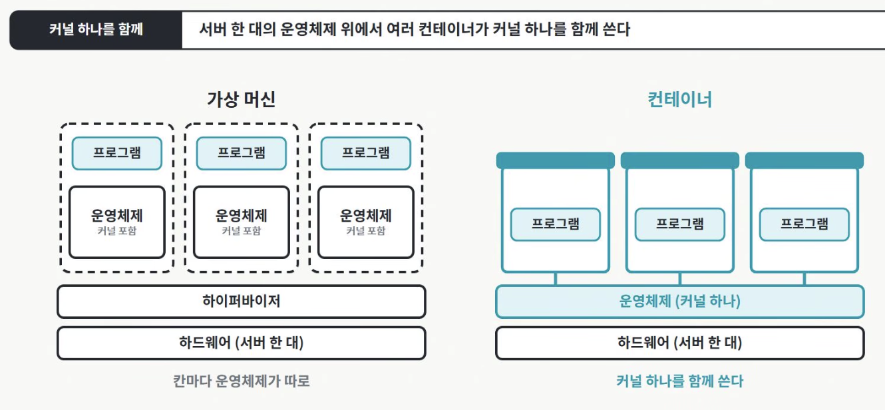
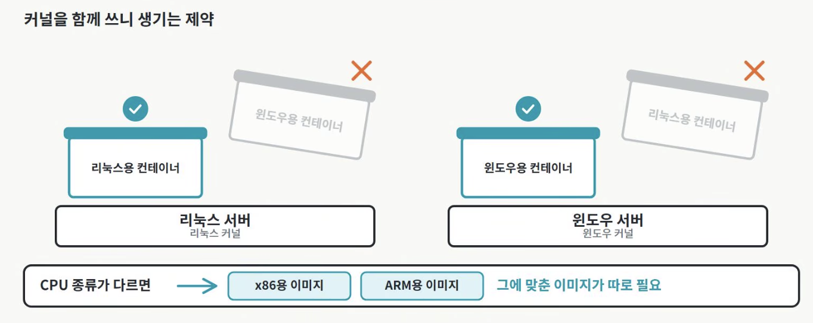

# Docker 컨테이너

다른 이름: Docker · 도커 · 컨테이너 · Container · Docker Container

주제: 실행 인프라

Docker로 이미지 기반 애플리케이션 실행 환경을 만들고 격리해 실행한다. 컨테이너라는 기술과 Docker라는 도구·플랫폼의 역할을 구분한다.

## 내 정리

 
- 가상머신과의 차이점 
   - 가상머신은 칸마다 운영체제가 따로 깔리지만, 컨테이너는 서버 한대의 운영 체제 위에서 여러 컨테이너가 커널 하나를 함께 씀
    - 커널은 CPU와 메모리를 프로그램들에게 나눠준다 → 컨테이너는 칸막이 안에서 도는 프로세스임 
- 커널 하나로 칸을 나누는 방법 : 리눅스 커널의 핵심 기능 2가지 사용 
    - **NameSpace** : == 컨테이너마다 보이는 세상을 따로 만들어준다. 컨테이너 안에서 실행 중인 프로그램 목록, 네트워크 주소, 컴퓨터 이름, 파일시스템 각각 다 서버 전체의 것이 보이는 것이 아니라 컨테이너 자체 것만 보여줌 ==
    - **씨그룹(cgroup, control group)**: == 컨테이너마다 쓸 수 있는 CPU와 메모리의 양을 정한다. ==

→ 커널에 종속성이 있어, 리눅스 서버에서는 리눅스용 컨테이너만, 윈도우 서버는 윈도우용 컨테이너만 직접 돌린다. 
→ 이와 동일하게 CPU 종류가 다르면 그에 맞춰 만든 이미지가 따로 필요하다. 

---

- 이 container의 표준이 Docker임

## 용어

### 이미지

애플리케이션 코드·사용자 공간 의존성·기본 설정 등을 담은 실행 템플릿이다. 실행 중인 컨테이너와 다르며 일반적인 컨테이너 이미지가 별도의 게스트 커널을 포함하는 것은 아니다.

### Dockerfile

베이스 이미지와 파일 복사·설치·실행 설정 등 이미지 빌드 단계를 선언하는 파일이다.

### 레지스트리

태그·다이제스트로 이미지를 저장·배포하는 서비스다. Docker Hub와 사설 레지스트리 등이 있다.

### 컨테이너 런타임

이미지를 준비하고 컨테이너의 실행·종료 등을 처리하는 구성 요소다. containerd와 저수준 런타임 runc 등을 역할별로 구분한다.

### namespace

Linux에서 프로세스 ID·네트워크·마운트 등 특정 자원의 보이는 범위를 분리하는 커널 기능이다.

### cgroup

다른 이름: control group

Linux에서 프로세스 집합의 CPU·메모리 등 자원 사용을 계측·제어하는 기능이다.

### 볼륨

컨테이너의 임시 쓰기 계층과 분리해 데이터를 보관·공유하는 저장 연결이다. 백업과 접근 권한은 별도로 설계한다.

### Docker Engine

이미지·컨테이너·네트워크·볼륨 등을 관리하는 데몬과 API를 제공하는 Docker의 실행 기반이다.

## Docker 컨테이너 · 핵심 개념과 연결

기록일: 2026-11-09T07:45:50.334Z

## 컨테이너와 Docker의 관계
컨테이너는 실행 환경을 격리하는 기술적 방식이고 Docker는 이미지 빌드·배포·컨테이너 실행을 제공하는 도구·플랫폼이다. 이 노드는 Docker를 중심으로 컨테이너의 공통 원리도 함께 다룬다.

## 실행 원리
일반적인 Linux 컨테이너는 호스트의 Linux 커널을 공유한다. namespace로 자원의 보이는 범위를 나누고 cgroup으로 자원 사용을 제어한다. 여기에 capabilities·seccomp 등 보안 설정을 조합한다. 컨테이너마다 별도 게스트 OS 커널을 부팅하는 VM과 다르다.

Docker Desktop에서 macOS·Windows 호스트로 Linux 컨테이너를 실행할 때는 Linux VM·WSL2 같은 실행 기반이 개입할 수 있다. 따라서 개발자 화면에 컨테이너만 보여도 VM 계층이 없다고 단정하지 않는다.

## 이미지에서 실행까지
`Dockerfile → 이미지 빌드 → 레지스트리에 배포 → 이미지 내려받기 → 컨테이너 실행`

이미지는 템플릿이고 컨테이너는 그 이미지를 바탕으로 생성·실행하는 인스턴스다. 하나의 이미지로 여러 컨테이너를 만들 수 있다. 컨테이너의 쓰기 계층은 교체·삭제될 수 있으므로 중요한 데이터는 볼륨·외부 저장소와 백업 정책으로 다룬다.

## 장점과 제약
- 코드와 사용자 공간 의존성을 이미지로 묶어 환경 차이를 줄이고 버전별로 배포할 수 있다.
- OS 전체를 인스턴스마다 부팅하지 않아 보통 시작과 자원 사용이 가벼운 편이다. 실제 비용은 워크로드·이미지·스토리지에 따라 달라진다.
- 같은 이미지라도 OS·CPU 아키텍처·커널 기능·환경 변수·외부 서비스 조건이 맞아야 한다. 어디서나 무조건 같은 동작을 보장하지는 않는다.
- 커널을 공유하므로 VM과 같은 격리 경계라고 보지 않는다. privileged 모드·Docker 소켓 노출·호스트 마운트와 비밀 정보 포함을 주의한다.

## Kubernetes와 연결
Kubernetes는 Docker 없이도 containerd·CRI-O 같은 CRI 호환 런타임으로 컨테이너를 실행할 수 있다. Docker로 빌드한 호환 이미지도 사용할 수 있으므로 이미지 제작 도구와 클러스터의 런타임을 구분한다. 여러 호스트의 배치·복구·확장이 필요할 때 오케스트레이션을 검토한다.
