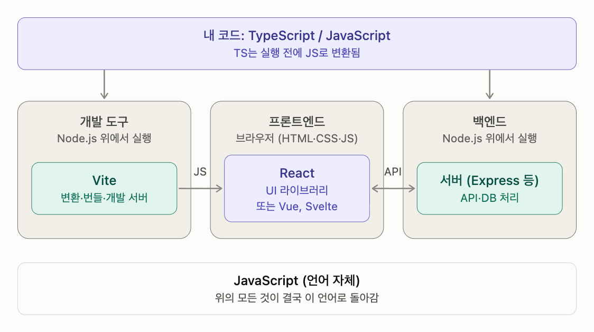

# JavaScript

다른 이름: JS

주제: 컴퓨터 언어

웹 브라우저에서 시작해 서버와 도구까지 확장된 동적 타입 언어다.

## 내 정리

== 웹 브라우저에서 시작해 서버와 도구까지 확장된 동적 타입 언어다. ==

## JavaScript 생태계 한눈에 보기: 언어, 런타임, 라이브러리, 빌드 도구

### 1. 각 요소의 정체와 영역

| 이름 | 정체 | 영역 |
|---|---|---|
| HTML / CSS | 화면의 구조 / 모양 | 프론트엔드 |
| JavaScript | 언어 | 프론트 + 백엔드 공통 |
| TypeScript | JS에 타입을 얹은 언어 (슈퍼셋) | 프론트 + 백엔드 공통 |
| Node.js | 브라우저 밖에서 JS를 실행하는 런타임 | 백엔드, 개발 도구 실행 |
| React | JS로 HTML을 만드는 UI 라이브러리 | 프론트엔드 |
| Vue / Svelte | React의 경쟁자, 같은 칸 | 프론트엔드 |
| Vite | 변환·번들·개발 서버를 맡는 빌드 도구 | 프론트엔드 개발 도구 |
| Rust | 별개의 시스템 언어, JS 도구의 내부 엔진 | JS 생태계 외부 |

### 2. 웹의 기본 3요소와 React

HTML은 구조, CSS는 모양, JS는 동작을 담당함. React는 이 중 JS 쪽에 속하고, JS 코드로 HTML을 생성하고 데이터가 바뀌면 HTML을 알아서 고쳐주는 역할임. React는 "HTML/CSS의 연장"이 아니라 "HTML을 JS로 프로그래밍하는 도구"로 보는 게 정확함.

- JSX는 HTML처럼 생겼지만 실제로는 JS임. 빌드할 때 함수 호출로 변환되고, `class` 대신 `className`을 씀.
- 브라우저는 React 컴포넌트를 모름. 최종적으로 받는 건 React가 만든 일반 HTML뿐임.
- React에는 스타일링 기능이 사실상 없음. CSS는 일반 CSS, CSS Modules, Tailwind 등으로 따로 입힘.

### 3. 핵심 포인트

- JS는 원래 브라우저 전용이었는데, Node.js 덕에 서버에서도 돌게 됨. 그래서 프론트와 백엔드를 JS/TS 한 언어로 짤 수 있게 됐고, 이게 JS 생태계가 커진 큰 이유임.
- TS는 브라우저도 Node.js도 직접 실행 못 함. 반드시 JS로 변환한 뒤 실행됨.
- Node.js의 본업은 백엔드 서버 실행이고, 프론트엔드에서는 Vite 같은 개발 도구를 돌리는 용도로 빌려 씀.
- React 프론트엔드에 Node.js가 필요한 건 개발·빌드 단계뿐임. 빌드 결과물은 정적 파일이라 아무 웹서버에 올려도 됨.

### 4. React와 Vite의 관계

서로 독립된 별개 물건임. React는 결과물 안에 포함되는 재료, Vite는 결과물을 만드는 주방 설비.

- Vite가 하는 일은 세 가지임. TS/JSX를 JS로 변환, 여러 파일을 배포용으로 묶는 번들링, 개발 중 로컬 서버 제공.
- Vite는 Vue, Svelte, 순수 JS에도 쓰이고, React도 Next.js나 webpack 등 다른 도구로 빌드 가능함.
- 연결 고리는 `@vitejs/plugin-react`. JSX 변환과 Fast Refresh(상태 유지한 채 수정된 컴포넌트만 교체)를 담당함.
- React 공식 도구였던 Create React App이 2025년에 deprecated되면서 "React + Vite"가 사실상 기본 조합으로 굳음. 공식 세트는 아님.

### 5. React의 경쟁자: Vue, Svelte

셋 다 UI를 컴포넌트 단위로 만드는 도구라 한 프로젝트에서는 보통 하나만 고름. 셋 다 Vite로 개발 가능함.

| | React | Vue | Svelte |
|---|---|---|---|
| 코드 스타일 | JS 안에 HTML(JSX) | HTML 템플릿 + JS + CSS 구역 분리 | HTML 중심, 가장 간결 |
| 동작 방식 | 브라우저에서 런타임이 계산 | React와 유사 | 빌드 시 컴파일러가 순수 JS로 변환 |
| 상위 프레임워크 | Next.js | Nuxt | SvelteKit |
| 특징 | 생태계, 채용 시장 최대 | 진입 장벽 낮음 | 결과물 가볍고 빠름, 생태계 최소 |

### 6. 실행 흐름

- 프론트엔드: TS + React 코드 작성 → Node.js 위에서 Vite가 JS로 변환·번들 → 브라우저가 받아서 React가 HTML을 생성, CSS로 스타일 적용
- 백엔드: TS/JS로 서버 코드 작성 → Node.js가 직접 실행 → 프론트엔드의 API 요청 처리

### 7. 익숙한 개념으로 비유하면

| JS 생태계 | ML 쪽 대응 |
|---|---|
| JS / TS | Python |
| Node.js | `python` 인터프리터 |
| React | PyTorch 같은 라이브러리 |
| Vite | 빌드 스크립트 겸 로컬 서버 |
| Rust (Vite 내부) | PyTorch 내부의 C++/CUDA |
| React vs Svelte | eager 실행 vs 미리 컴파일 |

## 용어

### ECMAScript

JavaScript의 핵심 언어 문법과 동작을 정의하는 표준이다.

### 동적 타입

값의 타입과 연산 적합성이 주로 실행 중 결정되는 타입 체계다.

### 이벤트 루프

대기 중인 작업과 콜백을 처리하는 실행 구조로 구체적인 동작은 호스트 환경에 의존한다.

## JavaScript · 역할과 핵심 개념

기록일: 2026-11-01T09:54:36.230Z

## TypeScript의 기반
JavaScript는 1995년 Netscape에서 Brendan Eich가 만들었고 ECMAScript로 표준화되었다. 브라우저에서는 웹 API와 함께, 서버·CLI에서는 Node.js 같은 호스트와 함께 실행된다.

값의 타입이 실행 중 결정되는 동적 타입 언어다. 엔진은 인터프리팅·JIT 컴파일 등을 조합할 수 있으므로 단순히 ‘컴파일되지 않는 언어’라고 분류하면 부정확하다.

TypeScript가 추가한 타입은 JavaScript의 실행 의미를 대신하지 않는다. 이벤트 루프·입출력·DOM 같은 기능은 언어 자체와 실행 환경의 역할을 나누어 이해해야 한다.
