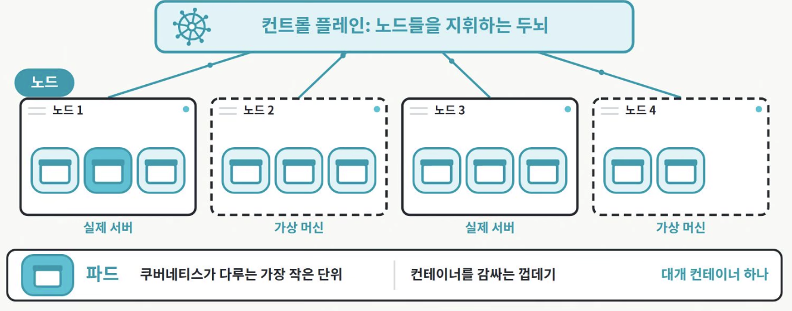
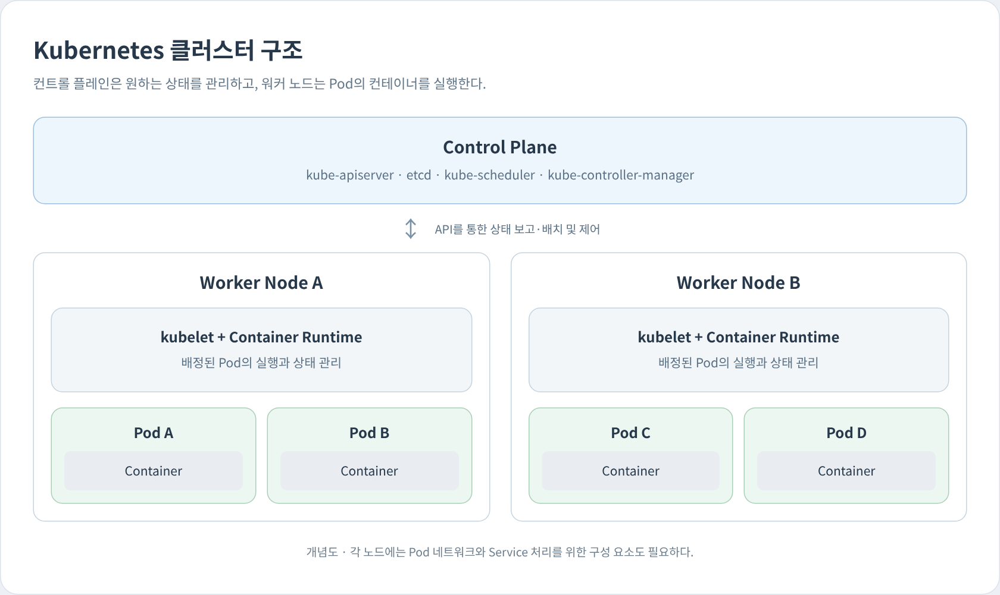
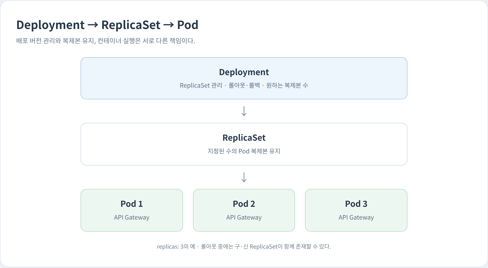
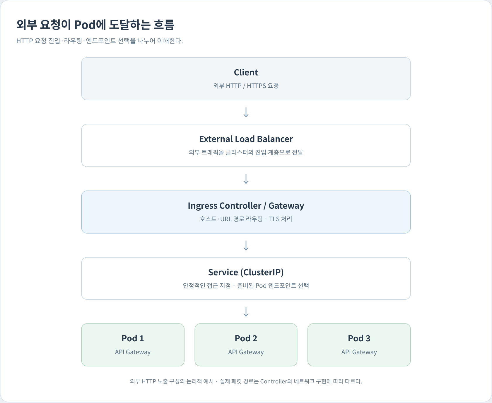
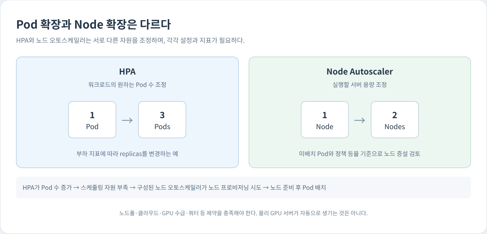

# Kubernetes

다른 이름: k8s · 쿠버네티스

주제: 실행 인프라

컨테이너 기반 워크로드의 원하는 상태를 선언하고 여러 노드에서 배치·확장·복구·서비스 연결을 관리하는 오케스트레이션 시스템이다.

## 내 정리

-   **오케스트레이션(Orchestration)**: 수많은 컨테이너를 어디에 배치할지, 컨테이너가 꺼지면 누가 다시 띄울지, 부하가 몰리면 누가 늘릴지를 관리하는 것.  
    대표적인 오케스트레이션 도구로 K8s(쿠버네티스)가 있음.

#### 개념



- 클러스터 = 컨트롤 플레인 + 워커 노드
   -  **노드(Node)** : 실제로 컨테이너를 실행하는 서버 한 대. 물리 서버일 수도 있고 가상 머신(VM)일 수도 있음.
   - **컨트롤 플레인(Control Plane)** : 노드들을 묶어서 지휘하는 두뇌
-  **파드 (Pod)** : 쿠버네티스가 다루는 가장 작은 단위. 컨테이너를 감싸는 껍데기로, 대개 컨테이너 하나가 들어감. (컨테이너 직접 띄우지 X)
   - 같은 Pod 안의 컨테이너는 네트워크 네임스페이스를 공유함. IP가 하나이고, 서로 `localhost`로 통신함.
    - Pod는 일회용으로 취급됨. 죽으면 같은 Pod가 살아나는 게 아니라 새 Pod가 새 IP로 생성됨. 그래서 보통 Deployment가 Pod 개수를 관리하고, 고정된 접근 주소는 Service가 제공함.
-  Desired State : 운영자가 적어둔 원하는 상태에 쿠버네티스가 지금 상태를 맞춘다. 
    - ex. 웹 서버 파드를 3개 늘 띄워놔라 → k8s 지금 싱태를 살피며 원하는 상태를 맞춤

- 이점 : 
   - 노드가 고장났을 때 : 사라진 파드만큼 다른 노드에 새 파드를 만든다
   -  Self Healing : 사라진 파드는 새로 만들고, 멈춘 컨테이너는 다시 시작
   - 사람이 몰릴 때 : CPU 사용률 같은 기준에 따라 파드 수를 늘리고 줄인다. 
   - 노드가 모자라면 : 클라우드에서는 가상 머신을 더 빌려 노드로 붙이기도 한다

## 용어

### Pod

Kubernetes가 배치하는 최소 실행 단위다. 하나 이상의 컨테이너가 네트워크와 일부 저장 자원을 공유한다.

### Deployment

주로 상태를 외부에 둔 워크로드의 Pod 복제본과 롤아웃을 선언·관리하는 리소스다.

### Service

변하는 Pod 주소 앞에 안정적인 접근 지점과 선택 규칙을 제공한다. 구체적인 트래픽 처리 방식은 Service 유형과 네트워크 구현에 따라 달라진다.

### 클러스터

컨트롤 플레인과 워커 노드 등 Kubernetes를 구성하는 실행·관리 자원의 집합이다.

### 컨트롤 플레인

API 서버·상태 저장·스케줄러·컨트롤러 등을 통해 클러스터의 원하는 상태를 관리한다.

### 워커 노드

Pod의 컨테이너가 실행되는 머신이다. VM이나 물리 서버를 사용할 수 있다.

### CRI

kubelet과 컨테이너 런타임 사이의 인터페이스다. Docker Engine 자체와 동일한 개념이 아니다.

### 선언적 관리

원하는 상태를 명세하면 컨트롤러가 실제 상태와의 차이를 반복적으로 조정하는 방식이다.

### ReplicaSet

다른 이름: RS

지정한 수의 Pod 복제본을 유지하는 컨트롤러 리소스다. Deployment가 롤아웃 과정에서 ReplicaSet을 관리한다.

### Ingress

외부 HTTP/HTTPS 요청의 호스트·경로 라우팅 규칙을 선언하는 API 리소스다. 규칙을 처리하는 Controller가 별도로 필요하다.

### Ingress Controller

Ingress 규칙을 실제 트래픽 처리로 구현하는 프로그램이다. Ingress 객체와 구분하며 Gateway API 기반 구현도 검토할 수 있다.

### Liveness Probe

다른 이름: 생존 상태 검사

복구 불가능한 상태 등을 검사해 실패 임계값을 넘으면 컨테이너를 종료하고 재시작 정책에 따라 재시작하게 한다. 단순 생존과 정상 추론 가능 여부는 다르다.

### Readiness Probe

다른 이름: 준비 상태 검사

현재 요청을 처리할 준비가 되었는지 검사한다. 준비되지 않은 Pod는 일반적인 Service의 정상 트래픽 대상에서 제외된다. 컨테이너를 재시작시키는 검사와 다르다.

### Startup Probe

다른 이름: 시작 상태 검사

앱의 시작 완료를 검사한다. 성공하기 전까지 liveness·readiness 검사를 유예하고, 실패 임계값을 넘으면 컨테이너 재시작 정책에 따른 처리가 이루어진다.

### HPA

다른 이름: Horizontal Pod Autoscaler

지정한 메트릭과 정책에 따라 대상 워크로드의 원하는 복제본 수를 조정한다. 메트릭 수집과 설정이 필요하며 Node나 GPU 서버를 직접 생성하지 않는다.

### Node Autoscaling

다른 이름: 노드 오토스케일링 · Node Autoscaler

미배치 Pod와 정책 등을 기준으로 노드 용량을 조정하는 기능·운영 체계다. Cluster Autoscaler·Karpenter 등의 구성과 클라우드·노드풀·쿼터 조건이 필요하다.

### requests

다른 이름: 자원 요청량

스케줄링에 사용할 자원 요청량이다. Node의 할당 가능 자원과 이미 예약된 요청량 등을 기준으로 배치를 결정한다.

### limits

다른 이름: 자원 상한

컨테이너 자원 사용 상한이다. 일반적으로 CPU는 throttling, 메모리는 OOM에 의한 프로세스 종료가 발생할 수 있다.

### CNI

다른 이름: Container Network Interface

컨테이너 네트워크 구성을 위한 인터페이스·플러그인 체계다. Kubernetes의 Pod 네트워크 구현에 Calico·Cilium 등을 사용할 수 있다.

### GPU Device Plugin

다른 이름: GPU 디바이스 플러그인

GPU 같은 장치를 노드의 확장 리소스로 광고하고 컨테이너에 할당하도록 지원한다. 모델의 여러 GPU 분할 실행은 추론 엔진과 배포 설정이 담당한다.

## Kubernetes · 핵심 개념과 연결

기록일: 2026-11-09T07:46:01.006Z

## 어떤 문제를 해결하는가
Kubernetes는 여러 노드에서 컨테이너 기반 워크로드를 배치하고 원하는 수의 인스턴스를 유지한다. 장애 시 재생성·재배치, 서비스 접근, 롤링 업데이트와 확장 등을 관리한다. 애플리케이션 코드의 오류나 데이터 정합성을 자동으로 해결하는 시스템은 아니다.

## 기본 구조
- **컨트롤 플레인**: API와 저장된 상태, 스케줄러·컨트롤러가 원하는 상태를 관리한다.
- **워커 노드**: kubelet과 컨테이너 런타임 등이 Pod를 실행한다. 노드는 VM 또는 물리 서버일 수 있다.
- **Pod**: 배치의 최소 단위다. Deployment는 주로 여러 Pod 복제본과 업데이트를 관리하고 Service는 Pod 집합에 대한 접근을 제공한다.

## Docker 컨테이너와의 차이
Docker는 컨테이너 제작·실행 도구·플랫폼이고 Kubernetes는 클러스터 수준의 오케스트레이션 시스템이다. Kubernetes 노드의 런타임은 Docker Engine일 필요가 없다. containerd·CRI-O 같은 CRI 호환 런타임을 사용할 수 있다.

## 배포 전략과 연결
Deployment는 RollingUpdate·Recreate 전략을 제공한다. readiness·종료 처리·자원 용량·구버전 호환성이 무중단 여부를 좌우한다. 정밀한 Canary나 Blue-Green 트래픽 제어는 Service·Ingress·게이트웨이·추가 롤아웃 도구 등을 조합해 설계한다. Kubernetes를 사용한다고 자동으로 카나리 배포가 완성되는 것은 아니다.

## 도입 판단
노드·네트워크·스토리지·보안·관측·업그레이드까지 운영해야 한다. 다중 서비스·다중 노드의 복구와 확장 요구가 이 복잡도를 정당화하는지 판단한다. 작은 서비스는 Docker나 관리형 컨테이너 플랫폼으로 시작할 수도 있다. 데이터베이스·볼륨의 백업과 장애 복구는 별도로 마련한다.

## Kubernetes 운영 흐름 · 배포·네트워크·복구·확장

기록일: 2026-11-09T10:16:38.014Z

Kubernetes 운영은 **배포·네트워크·상태 점검·자원·확장**을 하나의 흐름으로 이해하는 것이 핵심이다. LLM API Gateway와 모델 서빙을 예시로 각 계층의 역할을 구분한다.

## 1. 핵심 동작과 운영 조건

| 혼동하기 쉬운 이해 | 실제 동작과 조건 |
|---|---|
| Node = 컨테이너를 실행하는 서버 | 정확히는 **Worker Node**가 애플리케이션 Pod를 실행하는 역할. Control Plane도 Node 위에서 동작할 수 있음 |
| Pod가 죽으면 새 Pod 생성 | Pod 안의 컨테이너만 죽으면 같은 Pod 안에서 재시작할 수도 있음. Pod 자체가 삭제되거나 사라지면 Controller가 새 Pod 생성 |
| Deployment가 Pod 개수를 관리 | 정확히는 Deployment → ReplicaSet → Pod 구조 |
| 사람이 몰리면 Pod 자동 증가 | 기본적으로 자동 증가하지 않음. **HPA 설정 필요** |
| Node가 부족하면 VM 자동 추가 | 기본 기능은 아님. Cluster Autoscaler, Karpenter 등의 별도 구성이 필요 |
| Node가 고장 나면 다른 Node에 Pod 생성 | Controller가 새 Pod 생성을 시도하지만, 다른 Node에 충분한 자원이 있어야 실행 가능 |

핵심은 **K8s가 모든 것을 알아서 처리하는 것이 아니라, 설정된 Desired State와 각종 Controller를 기반으로 동작한다**는 점.

## 2. K8s 전체 구조 이해하기



### 2-1. Control Plane 내부 구성 요소

Control Plane도 하나의 프로그램이 아니라 여러 컴포넌트의 집합임.

| 구성 요소 | 역할 |
|---|---|
| `kube-apiserver` | Kubernetes의 API 진입점. 명령과 리소스 변경 요청을 처리 |
| `etcd` | 클러스터의 리소스 정의와 상태 정보를 저장하는 Key-Value DB |
| `kube-scheduler` | 새 Pod를 어느 Node에 배치할지 결정 |
| `kube-controller-manager` | 현재 상태를 Desired State와 비교하고 필요한 변경을 수행하도록 Controller 실행 |

예를 들어 운영자가 `Pod 3개를 실행하라`고 설정하면 다음과 같이 동작함.

1. 사용자가 `kubectl apply` 명령 실행
2. API Server가 요청을 받고 리소스 정의를 etcd에 저장
3. Deployment Controller가 ReplicaSet을 통해 필요한 Pod 생성
4. Scheduler가 각 Pod를 실행할 Node 선택
5. 해당 Node의 kubelet이 Container Runtime을 통해 컨테이너 실행

여기서 중요한 구분:

- **Scheduler:** 어디서 실행할지 결정
- **Controller:** 몇 개가 있어야 하고 무엇을 변경해야 하는지 관리
- **kubelet:** 배정된 Node에서 실제로 실행되도록 관리

공식 구조: [Kubernetes Components](https://kubernetes.io/docs/concepts/overview/components/)

### 2-2. Worker Node 내부 구성 요소

| 구성 요소 | 역할 |
|---|---|
| kubelet | Node에 배정된 Pod를 실행하고 상태를 감시 |
| Container Runtime | 실제 컨테이너 생성·실행. 예: containerd |
| kube-proxy | Service 트래픽 전달을 위한 네트워크 규칙 관리. 일부 CNI 환경에서는 다른 구현으로 대체 |
| CNI Plugin | Pod 간 네트워크 연결 제공. 예: Calico, Cilium |

즉, Docker나 containerd 같은 컨테이너 기술과 K8s의 차이는 다음과 같음.

- **Container Runtime:** 컨테이너 하나를 실제로 실행
- **Kubernetes:** 여러 서버에 걸쳐 컨테이너들을 어디에, 몇 개, 어떤 방식으로 실행할지 관리

---

## 3. Pod, ReplicaSet, Deployment의 관계

이 셋은 반드시 계층적으로 이해하는 게 좋음.



### 각각 무엇을 관리할까?

- **Pod:** 실제 애플리케이션 컨테이너가 실행되는 환경
- **ReplicaSet:** Pod 복제본을 지정된 개수로 유지
- **Deployment:** ReplicaSet을 관리하면서 애플리케이션 배포 및 버전 업데이트 지원

예를 들어 `replicas: 3`이라면,

- 현재 Pod 3개 → 유지
- Pod 1개가 사라져 2개 → 새 Pod 1개 생성
- replicas를 5로 변경 → Pod 2개 추가
- 새로운 이미지 버전 배포 → 새 ReplicaSet을 만들고 Pod를 순차적으로 교체할 수 있음

여기서 **Pod가 하나 죽었다고 Deployment가 무조건 Pod 전체를 다시 만든다는 뜻은 아님.** 컨테이너만 비정상 종료된 경우 kubelet이 기존 Pod 안에서 컨테이너를 재시작할 수 있음.

### Rolling Update

예를 들어 API Gateway v1을 운영하다 v2를 배포한다고 가정.

- 기존: v1 Pod 3개
- 목표: v2 Pod 3개
- Rolling Update: 새 Pod를 점진적으로 실행하고 기존 Pod를 순차적으로 종료
- 장점: 모든 Pod를 동시에 내리지 않고 업데이트 가능

단, 무중단 배포가 완전히 보장되는 것은 아님. Readiness Probe, 종료 유예 시간, 여유 자원, 기존 요청 처리 등을 제대로 설정해야 함.

공식 문서: [Deployment](https://kubernetes.io/docs/concepts/workloads/controllers/deployment/)

---

## 4. Service와 Ingress — 외부 요청은 어떻게 Pod까지 도달할까?

외부 요청의 진입과 내부 서비스 연결을 구분한다.

Pod는 생성과 삭제가 반복되므로 클라이언트가 특정 Pod IP를 직접 기억하는 구조는 적합하지 않음.

따라서 **Service라는 안정적인 접근 지점**이 필요함.



### 4-1. Service

Service는 여러 Pod를 하나의 논리적인 네트워크 엔드포인트로 제공함.

예를 들어 다음과 같은 Pod 3개가 존재한다고 가정.

```text
Pod A: 10.244.1.10:8000
Pod B: 10.244.1.11:8000
Pod C: 10.244.2.15:8000
```

이를 Service로 묶으면 다른 애플리케이션은 개별 Pod IP 대신 다음 주소로 요청할 수 있음.

```text
http://llm-gateway:8000
```

- `llm-gateway`: Service 이름
- 내부 DNS가 Service 주소를 해석
- 일반적인 Service 구현이 준비된 Pod 엔드포인트 중 하나로 연결을 전달
- Pod가 교체되어 IP가 바뀌어도 Service 주소는 일반적으로 유지

단, 일반적인 Kubernetes Service의 분산은 주로 네트워크 연결 수준에서 이루어짐. **LLM 모델의 GPU 여유 메모리, 요청 토큰 수, 추론 비용, Azure 429 등을 이해해서 라우팅하는 기능은 제공하지 않음.** 그런 정책은 별도의 LLM Gateway나 라우팅 계층에서 구현해야 함.

### 4-2. Ingress

Ingress는 외부 HTTP/HTTPS 요청을 어떤 Service로 보낼지 정의하는 API 리소스임.

예시:

```text
api.company.com/llm   → llm-gateway Service
api.company.com/rag   → rag-service Service
api.company.com/admin → admin-service Service
```

중요한 구분:

- **Ingress:** 트래픽 라우팅 규칙
- **Ingress Controller:** 그 규칙을 실제로 적용해 트래픽을 처리하는 프로그램
- **Nginx:** Ingress Controller의 구현 등에 사용될 수 있는 웹 서버·Reverse Proxy

즉, Ingress 객체만 생성했다고 외부 라우팅이 자동으로 동작하는 것은 아님. 이를 처리할 Controller가 필요함. Gateway API도 유사한 문제를 해결하는 더 확장 가능한 방식임.

### 4-3. Service 종류

| 타입 | 역할 |
|---|---|
| `ClusterIP` | 클러스터 내부 통신. 기본값 |
| `NodePort` | 각 Node의 특정 Port를 통해 접근 |
| `LoadBalancer` | 지원되는 외부 Load Balancer와 연동해 서비스 노출 |
| `ExternalName` | 내부 DNS 이름을 외부 DNS 이름에 매핑 |

일반적인 내부 API 서버는 ClusterIP를 사용하고, 외부 노출은 Ingress Controller 또는 Gateway 등의 계층을 통해 처리하는 구성이 흔함.

공식 문서: [Service](https://kubernetes.io/docs/concepts/services-networking/service/) · [Ingress](https://kubernetes.io/docs/concepts/services-networking/ingress/)

Ingress Controller가 Service의 엔드포인트를 직접 선택하는 등 실제 패킷 경로는 구현에 따라 다를 수 있다. 위 도식은 논리적 역할을 설명하며 Service의 가상 IP를 반드시 통과한다는 뜻은 아니다. `ExternalName`은 DNS 별칭을 제공하고 자체적으로 프록시나 부하 분산을 수행하지 않는다.

## 5. Self Healing과 Health Check

K8s가 애플리케이션의 건강 상태를 어떻게 판단하는지 이해해야 함.

특히 중요한 것이 **Probe**라는 개념임.

| 종류 | 확인하는 질문 | 실패 시 동작 |
|---|---|---|
| Liveness Probe | 프로세스가 정상적으로 살아 있는가? | 일정 횟수 실패 시 컨테이너 재시작 |
| Readiness Probe | 지금 요청을 처리할 준비가 되었는가? | Service의 트래픽 대상에서 제외 |
| Startup Probe | 애플리케이션 시작 과정이 완료되었는가? | 성공 전까지 Liveness/Readiness 검사 유예. 계속 실패하면 재시작 |

예를 들어 vLLM 모델 서버를 배포한다고 가정.

- 모델 로딩 중 → 프로세스는 살아 있지만 추론 요청을 처리할 준비는 안 됨
- Readiness Probe 실패 → Service가 해당 Pod로 요청을 보내지 않음
- 모델 로딩 완료 → Readiness Probe 성공 → 요청 전달 가능
- 이후 프로세스가 복구 불가능한 비정상 상태에 빠지고 Liveness Probe 실패 → 컨테이너 재시작

주의: 프로세스가 살아 있다는 사실만으로 실제 추론이 정상 수행된다는 뜻은 아님. Health Check 엔드포인트를 무엇으로 정의할지가 중요함.

공식 문서: [Probes](https://kubernetes.io/docs/concepts/configuration/liveness-readiness-startup-probes/)

## 6. CPU, Memory, GPU 자원은 어떻게 관리할까?

Pod를 배포할 때 필요한 자원을 지정할 수 있음.

### Requests와 Limits

```yaml
resources:
  requests:
    cpu: "1"
    memory: "2Gi"
  limits:
    cpu: "2"
    memory: "4Gi"
```

- **Requests:** 해당 Pod가 스케줄링될 때 필요한 것으로 선언한 자원량. Scheduler가 Node를 선택하는 주요 기준
- **Limits:** 컨테이너에 적용하는 자원 사용 상한

CPU와 메모리에서 Limits 초과 시 동작이 다름.

- CPU Limit 초과 → 일반적으로 CPU 사용이 Throttling되어 처리 속도 저하
- Memory Limit 초과 → OOM 발생 시 컨테이너 프로세스 종료 가능

예를 들어 Node에 할당 가능한 CPU가 8개이고, 이미 CPU Requests 6개가 예약되어 있다면 CPU Requests 4개인 새 Pod는 그 Node에 배치할 수 없음.

### GPU도 동일하게 관리할까?

GPU는 보통 Device Plugin 등을 통해 확장 리소스로 관리함.

```yaml
resources:
  limits:
    nvidia.com/gpu: 1
```

- GPU 1개를 필요로 하는 Pod라는 의미
- GPU 자원이 없는 Node에는 일반적으로 스케줄링되지 않음
- GPU 모델이나 메모리 크기가 적합한지는 Node Label, 스케줄링 제약 등을 추가로 설정해야 함
- GPU 전체를 한 Pod가 독점하는 기본 방식 외에도 MIG, GPU 공유 등 별도 구성이 가능

**중요:** GPU가 4개 있는 Node라고 해서 K8s가 모델을 자동으로 4개 GPU에 분산해 실행해 주는 것은 아님. Tensor Parallelism이나 모델 실행 방식은 vLLM/SGLang 등의 추론 엔진과 배포 설정이 담당함.

---

## 7. Autoscaling — Pod를 늘리는 것과 Node를 늘리는 것은 다름



예시 상황:

1. API 요청량 증가 → Pod의 CPU 사용률 상승
2. 설정된 HPA가 관측 지표에 따라 Deployment의 Replica 수 증가
3. Scheduler가 새 Pod를 배치하려 하지만 Node에 자원 부족
4. Node Autoscaler가 구성되어 있다면 새 Node 프로비저닝 시도
5. Node 준비 완료 후 Pod 배치 및 실행

다만 온프레미스 환경에서 GPU 서버가 부족하다면 K8s가 물리 GPU 서버를 새로 만들어낼 수는 없음.

또한 **LLM 추론 서비스의 확장 기준은 CPU 사용률만으로 충분하지 않을 수 있음.** GPU 사용률, KV Cache, 대기 요청 수, 처리 중인 토큰 수와 같은 지표를 고려한 Custom Metrics 기반 확장이 필요할 수 있음.

공식 문서: [HPA](https://kubernetes.io/docs/concepts/workloads/autoscaling/horizontal-pod-autoscale/) · [Node Autoscaling](https://kubernetes.io/docs/concepts/cluster-administration/node-autoscaling/)

## 8. 실제 Deployment 설정 예시

API Gateway를 K8s에 배포한다면 다음과 같은 YAML을 작성할 수 있음.

```yaml
apiVersion: apps/v1
kind: Deployment
metadata:
  name: llm-gateway
spec:
  replicas: 3
  selector:
    matchLabels:
      app: llm-gateway
  template:
    metadata:
      labels:
        app: llm-gateway
    spec:
      containers:
        - name: gateway
          image: example/llm-gateway:v1
          ports:
            - containerPort: 8000
          resources:
            requests:
              cpu: "500m"
              memory: "512Mi"
            limits:
              cpu: "2"
              memory: "2Gi"
          readinessProbe:
            httpGet:
              path: /ready
              port: 8000
            periodSeconds: 5
```

이 YAML이 의미하는 것:

- `replicas: 3`: Gateway Pod 3개 유지
- `selector.matchLabels`: Deployment가 관리할 Pod를 Label로 식별
- `image`: 실행할 컨테이너 이미지 지정
- `containerPort`: 컨테이너 애플리케이션이 사용하는 Port 정보
- `requests/limits`: 자원 요청량과 상한 지정
- `readinessProbe`: `/ready` 응답으로 요청 처리 준비 상태 확인

Service를 별도로 생성하면 다음처럼 Pod들을 하나의 주소로 연결할 수 있음.

```yaml
apiVersion: v1
kind: Service
metadata:
  name: llm-gateway
spec:
  type: ClusterIP
  selector:
    app: llm-gateway
  ports:
    - port: 8000
      targetPort: 8000
```

여기서 `selector.app: llm-gateway`가 Deployment에서 생성한 Pod의 Label과 일치하기 때문에 Service가 해당 Pod들을 엔드포인트로 사용함.

이 예제의 이미지는 설명용이다. 실제 앱이 `/ready`를 구현해야 하며, `containerPort`를 선언하는 것만으로 외부에 포트가 공개되지는 않는다. 무중단 운영에는 startup/liveness 설정, 종료 처리와 여유 용량 등을 추가로 검토한다.

## 9. 실제 운영 시 자주 쓰는 명령어

| 명령어 | 용도 |
|---|---|
| `kubectl get nodes` | Node 목록 및 상태 |
| `kubectl get pods -o wide` | Pod 상태, IP, 배치된 Node 확인 |
| `kubectl get deployments` | Deployment 상태 및 Replica 수 확인 |
| `kubectl get svc` | Service 주소와 Port 확인 |
| `kubectl describe pod <pod>` | Pod의 상세 상태와 Event 확인 |
| `kubectl logs <pod>` | 컨테이너 로그 확인 |
| `kubectl top pods` | CPU/메모리 사용량 확인(메트릭 수집 필요) |
| `kubectl rollout status deployment/llm-gateway` | 배포 진행 상태 확인 |
| `kubectl rollout undo deployment/llm-gateway` | 이전 배포 Revision으로 롤백 |

---

`kubectl rollout undo`는 Deployment의 Pod 템플릿 리비전을 되돌린다. DB 변경·외부 부작용까지 되돌리거나 모든 설정을 복구하는 명령은 아니다.

## 10. LLM 플랫폼 관점에서 가장 중요한 구분

| 계층 | 담당하는 것 |
|---|---|
| Kubernetes | Pod 배포, Node 스케줄링, 복제본 관리, 장애 복구 |
| Kubernetes Service | Pod 엔드포인트 제공 및 네트워크 트래픽 분산 |
| Ingress / Nginx | 외부 HTTP 트래픽 진입, Path 라우팅, TLS 종료 등 |
| LLM API Gateway | API Key 인증, 모델 라우팅, 사용량 제한, Fallback, 로깅 |
| vLLM / SGLang | 모델 로딩, GPU 메모리 관리, 추론 스케줄링, 배치 처리 |

예를 들어 사용자에게 LLM 요청이 들어온다고 가정.

```text
Client
  ↓
Ingress / Nginx
  ↓
API Gateway Service
  ↓
API Gateway Pod
  ├── Azure OpenAI API
  └── vLLM Service
        ↓
      vLLM Pod
        ↓
      GPU
```

여기서 각 계층의 책임은 구별됨.

- K8s는 Gateway Pod가 3개 실행되도록 관리
- Service는 Gateway Pod로 네트워크 연결을 전달
- Gateway는 어떤 모델로 보낼지, Fallback할지 결정
- vLLM은 실제 GPU 추론 실행

**K8s가 관리하는 것은 애플리케이션 실행 환경이고, LLM Gateway가 관리하는 것은 추론 요청의 처리 정책**이라고 보면 됨.

### 추가로 공부할 개념

지금까지 동작 흐름을 이해했다면 아래 개념까지 연결하면 실무 구조를 상당 부분 이해할 수 있음.

- **Namespace:** 하나의 Cluster 안에서 리소스를 논리적으로 구분한다. 그 자체가 네트워크·보안 격리를 모두 보장하지는 않는다.
- **ConfigMap / Secret:** 환경 설정과 비밀번호·토큰 등의 민감한 설정값 관리. Secret의 base64 표현 자체는 암호화가 아니며 RBAC·저장 시 암호화·비밀 관리 정책이 필요하다.
- **PV / PVC:** Pod가 교체되어도 필요한 데이터를 저장소에 유지
- **StatefulSet:** 고정된 식별자와 지속 저장소가 필요한 Stateful 애플리케이션 관리
- **DaemonSet:** 각 Node마다 로그 수집기나 모니터링 에이전트 등을 실행
- **Job / CronJob:** 한 번 실행하고 끝나는 작업 또는 정기 배치 작업

개념을 연결해 이해할 순서는 **Deployment → Service → Ingress → Probe → Scheduler/Resources → HPA**임. 이 흐름을 이해하면 실제 운영 중 발생하는 `Pending`, `CrashLoopBackOff`, `OOMKilled`, `502/503`, 배포 중 연결 끊김 등의 문제도 어느 계층에서 발생했는지 구분하기 쉬워짐.
