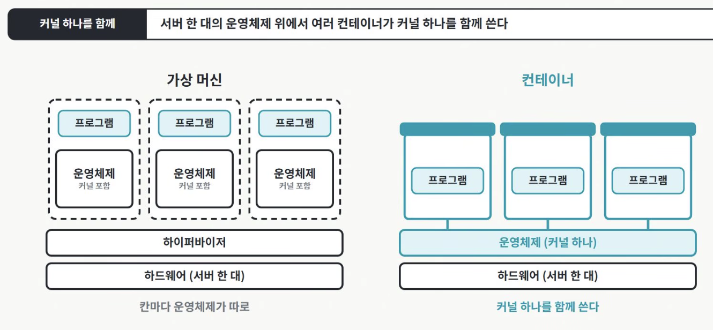
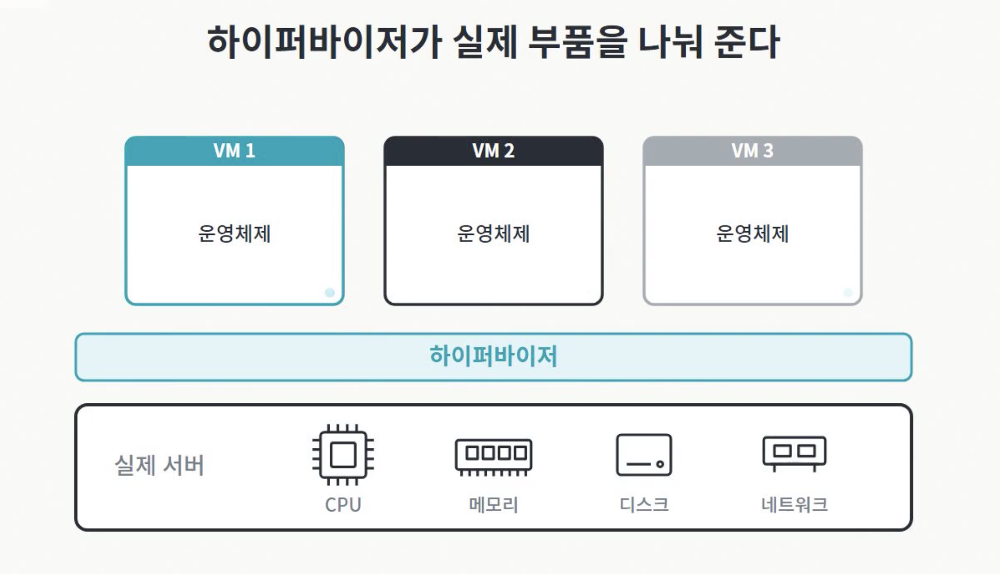
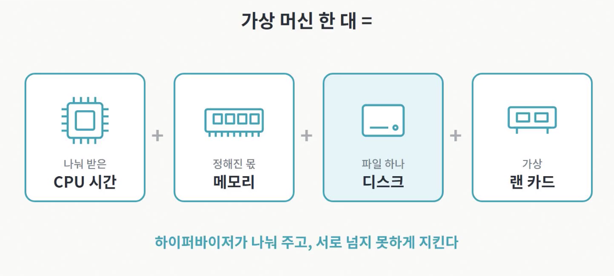
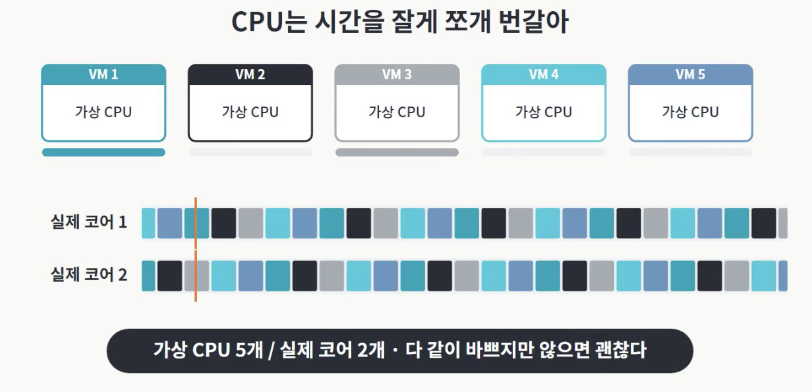
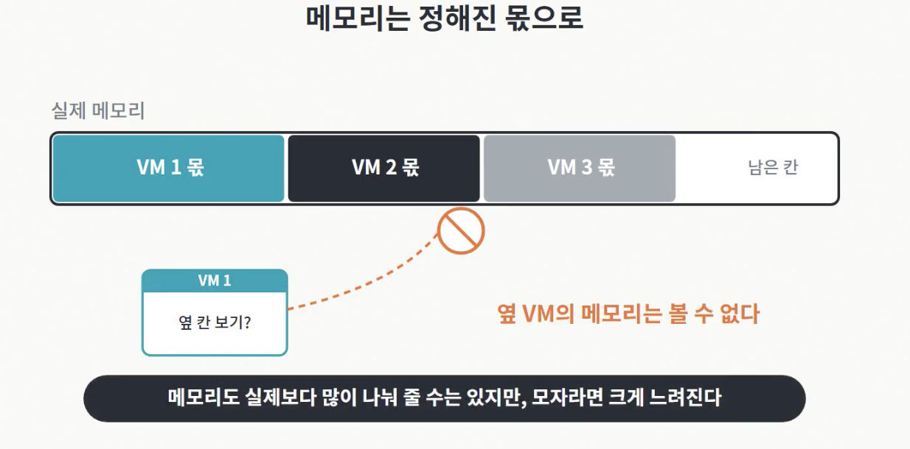
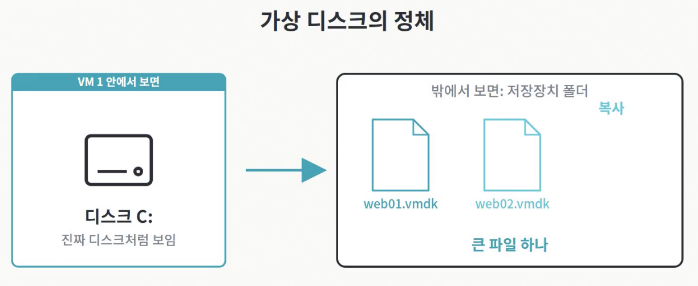
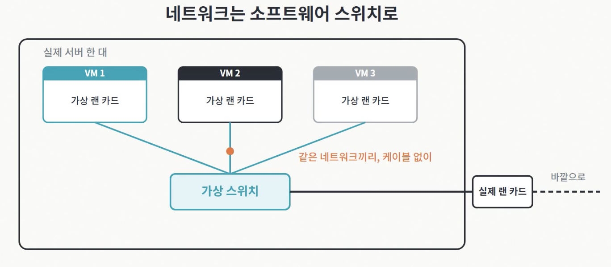
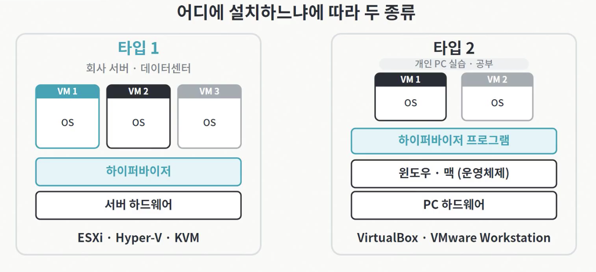
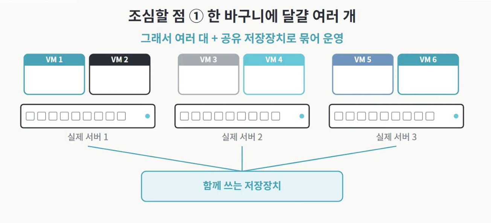

# 가상머신

다른 이름: VM · Virtual Machine · 가상 머신

주제: 실행 인프라

하이퍼바이저가 제공하는 가상 하드웨어 위에서 독립적인 게스트 OS를 실행하는 환경이다.

## 내 정리

- 하이퍼바이저는 실제 서버의 CPU, 메모리, 디스크, 네트워크를 나눠서 가상 머신마다 할당해주는 소프트웨어
- 가상머신 안에는 운영체계가 따로 깔린다 & 옆 가상머신이 멈춰도 내 가상 머신은 그대로다 → "격리"

### 하이퍼바이저가 서버 한 대를 실제로 나누는 방법 (CPU/메모리/디스크/네트워크)

#### 1) CPU 

- 가상 머신은 가상 CPU를 받지만, 실제 코어를 통으로 떼어주는 것은 아님 
- 하이퍼바이저가 실제 코어의 시간을 아주 잘게 쪼개서, 가상 머신들에게 번갈아 나눠줌
- 이 전환이 워낙 빨라서 가상 머신은 CPU를 혼자 쓰는 것처럼 동작함 
-  그래서 실제 코어 수보다 가상 CPU를 더 많이 나눠줄 수 있음

#### 2) 메모리 

- 하이퍼바이저는 가상 머신마다 쓸 메모리 크기를 정해서 나눠줌
- 가상 머신은 자기 몫만 볼 수 있도 옆 VM의 메모리는 볼 수 없음 
- 메모리도 실제보다 많이 나눠 줄 수는 있지만, 모자라면 크게 느려짐

#### 3) 디스크 

- 가상 머신이 쓰는 디스크는 대개 저장장치 안에 있는 큰 파일 하나 
- 가상 머신 안에서는 디스크 한 개로 보이지만 밖에서 보면 파일이라서 복사하고 옮기기가 쉬움

#### 4) 네트워크

- 하이퍼바이저 안에는 소프트웨어로 만든 스위치가 있어서, 가상 머신들이 여기에 연결됨 
- 같은 서버 안에서 같은 네트워크에 묶인 가상 머신끼리는 케이블 없이 가상 스위치로 통신함 
- 바깥과는 실제 랜 카드를 거쳐 나감

### 하이퍼바이저의 종류 

- 어디에 설치하느냐에 따라 두 종류로 나눌 수 있음 

 

#### Type 1  : 서버 하드웨어 위에 바로 깔리는 타입 (회사 서버에서의 가상화)
-  하이퍼바이저가 맨 아래 층에서 하드웨어를 직접 다룸 
- 중간 단계가 없어서 빠르고 안정적이라, 주로 회사 서버 or 데이터센터에서 사용 
- 대표 제품 : VMware의 ESXi, MS의 Hyper-V, 리눅스의 KVM 
    - Hyper-V와 KVM은 윈도우 서버/리눅스에 들어있는 기능이지만 하드웨어 바로 위에서 돌아 Type 1 

#### Type 2 : 운영체제 위에 프로그램처럼 설치하는 타입 
- 대표적으로 버추얼 박스와 VMware 워크스테이션이 있음 
- 설치가 쉬워, 개인 PC에서 다른 운영체제를 시험해보거나 공부할 때 많이 사용 

### 가상화의 이점과 단점 
- 이점
   - 1) 서버 수 줄어짐 : 놀던 서버 여러 대의 일을 실제 서버 한 대에 가상 머신으로 모음 (→ 서버 통합) 
  - 2) 서버를 파일처럼 다룰 수 있게 됨 : 새 서버가 필요하면 장비를 사서 설치하는 대신, 미리 만든 가상 머신을 복사해서 바로 띄움 
     - 업데이트 전에는 스냅샷을 찍어둠 → 업데이트가 잘못되면 스냅샷 찍은 시점으로 롤백함  
  - 3) 라이브 마이그레이션 가능 : 실제 서버를 점검해야 할 때, 그 위의 가상 머신을 끄지 않고 다른 서버로 옮김 
     -  == 디스크 파일은 보통 여러 서버가 함께 쓰는 저장장치에 있어서, 옮길 것은 주로 메모리임 ==
     - 가상 머신이 돌아가는 동안 메모리 내용을 새 서버로 미리 복사함 → 복사하는 사이에 바뀐 부분을 몇 번 더 보내, 차이를 줄인 후 마지막에만 잠깐 멈춰서 전환
  - 4) 고장에 강건해짐 : 실제 서버 여러 대를 한 묶음으로 운영하다가 한 대가 고장나면, 그 위의 가상 머신을 다른 서버에서 자동으로 다시 켬  (단, 이 켜는 행위는 사람이 할 때까지는 끊겨있음)

- 단점 
  - 1) 실제 서버 한 대가 고장 나면, 그 위의 가상 머신 여러 대가 한꺼번에 멈춤 
      -  == 그래서 가상화는 보통 실제 서버 여러 대와, 그 서버들이 함께 쓰는 저장치를 묶어서 운영 == 
  - 2) 너무 많이 몰아넣으면 서로 느려짐 : 모든 가상 머신이 바쁘면 실제 코어를 기다리는 시간이 생김 
  - 3) 스냅샷은 백업이 아니다 : 가상 머신 스냅샷은 원래 디스크에서 바뀐 내용만 따로 적어두는 방식이라 원래 디스크가 망가지면 쓸모 없어짐 

## 용어

### 하이퍼바이저

CPU·메모리·장치 등 물리 자원을 가상 머신에 제공하고 실행을 중재하는 계층이다.

### 게스트 OS

VM 내부에서 실행되는 운영체제다. 호스트·하이퍼바이저와 별도의 커널을 가진다.

### vCPU

가상 머신에 노출되는 논리 CPU 자원이다. 물리 CPU와의 매핑·공유 방식은 제공 환경에 따라 다르다.

### 가상 디스크

게스트 OS에 디스크처럼 제공되는 저장 장치다. 파일·블록 스토리지 등 실제 구현과 영속성 정책을 확인해야 한다.

## 가상머신 · 핵심 개념과 연결

기록일: 2026-11-09T07:45:38.579Z

## 무엇을 가상화하는가
가상머신은 CPU·메모리·네트워크·디스크 같은 하드웨어 자원을 가상화하고 그 위에 게스트 OS를 실행한다. KVM·VMware 계열 하이퍼바이저와 클라우드의 가상 서버가 대표적인 예다.

## 컨테이너와의 차이
VM마다 게스트 커널과 OS 사용자 공간을 구성하므로 서로 다른 OS 환경을 운영하고 격리 경계를 두기 좋다. 대신 OS 부팅·메모리·패치·디스크 관리 비용이 발생한다. 격리 수준은 하이퍼바이저와 설정에 의존하므로 절대적인 보안 보장으로 보지는 않는다.

컨테이너는 호스트 커널을 공유하는 방식이므로 일반적으로 더 가볍게 실행할 수 있다. VM과 컨테이너는 배타적인 대안만은 아니며 VM 안에서 컨테이너를 실행할 수 있다.

## 사용할 때 확인할 것
- 게스트 OS·CPU 아키텍처·가상화 지원과 라이선스 조건.
- CPU·메모리 할당과 과할당, 스토리지·네트워크 성능.
- OS 이미지·보안 업데이트·백업·복구 및 접근 권한.
- Kubernetes 워커 노드로 사용할 경우 런타임·네트워크·스토리지 연결.

## 가상화란? 서버 한 대가 여러 대가 되는 원리 | VM·하이퍼바이저 기초

기록일: 2026-11-09T07:55:37.851Z

[참고 링크](https://www.youtube.com/watch?v=A6dsy9CTvII)
