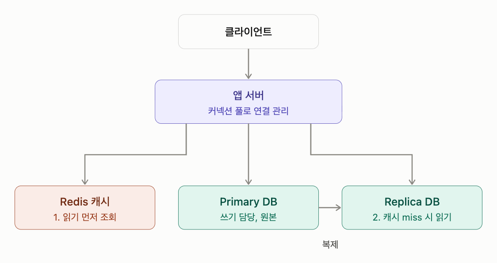

# 데이터베이스

다른 이름: DB · Database · 백엔드 DB 설계 · Backend Database Design · 스키마 설계 · Schema Design · 데이터 모델링 · DB 마이그레이션 · Database Migration · 스키마 마이그레이션

주제: DB

데이터 모델·정합성·접근 패턴·운영 비용에 맞춰 저장소를 선택하는 기술.

## 내 정리



요청 종류에 따라 흐름이 두 갈래로 나뉨.
- **읽기 요청**은 앱 서버가 먼저 Redis에서 찾아봄. 있으면(cache hit) 바로 응답해서 DB까지 안 감. 없으면(cache miss) Replica DB에서 읽어오고, 그 결과를 Redis에 TTL과 함께 저장해둬서 다음 요청부터는 캐시에서 바로 꺼내 씀.
- **쓰기 요청**은 반드시 Primary DB로 감. 원본은 Primary 하나뿐이고, 여기에 쓴 내용이 Replica로 복제됨. 쓰기 후에는 Redis에 있던 해당 데이터를 지우거나 갱신해야 오래된 값이 응답되지 않음.

앱 서버와 세 저장소 사이의 연결은 전부 커넥션 풀이 관리함.

---- 
## 0단계. 원칙
- 데이터 종류별로 원본(Source of Truth)을 명확히 정한다. ==단일 Primary 구성에서는 쓰기를 Primary로 모으고 Replica는 복제본, 캐시는 보조 계층으로 취급한다. == 모든 시스템이 반드시 단일 Primary여야 하는 것은 아니다.
- 데이터의 정합성·조회 방식·보존 요구에 맞는 저장소에 배치한다.
- 단순하게 시작하고 지표로 병목을 확인한 뒤 확장한다.

## 1단계. 요구사항 정리
- 데이터 종류, 현재 용량과 증가 속도, 읽기·쓰기 비율과 피크 트래픽을 파악한다.
- 평균뿐 아니라 p95·p99 응답 시간 등 목표 지연을 정한다.
- 허용 가능한 데이터 유실 범위(RPO)와 목표 복구 시간(RTO)을 정한다.
- 읽기 직후 최신 값이 필요한지, 일정한 지연을 허용하는지도 구분한다.

## 2단계. 데이터 분류와 저장소 배치

| 항목 | Redis | ==RDB (MySQL, PostgreSQL)== | 문서형 NoSQL (MongoDB) |
| --- | --- | --- | --- |
| 저장 위치 | ==메모리 중심==  | 디스크 중심 | 디스크 중심 |
| 속도 | 보통 sub-ms 수준 | ms 단위 | ms 단위 |
| 데이터 모델 | key-value + 자료구조(String, Hash, List, Set, Sorted Set 등) | 테이블, 스키마, 관계 | JSON 형태 문서 |
| 쿼리 | 키 기반 명령어, 복잡한 조회 약함 | SQL, JOIN, 집계 강력 | 필드 기반 쿼리, 인덱스 |
| 트랜잭션 | MULTI/EXEC, Lua 스크립트 수준 | ACID 완전 지원 | 문서 단위 원자성, 멀티 문서 트랜잭션 지원 |
| 용량 | 메모리 크기에 제한됨 | 대용량 가능 | 대용량 가능 |
| 시스템 내 위치 | ==앱 서버와 메인 DB 사이 보조 계층== | ==서비스의 메인 저장소(원본==) | ==메인 저장소 또는 로그/콘텐츠 전용 저장소== |
| 주 활용처 | 캐시, 로그인 세션, rate limit, 분산 락, 랭킹, 작업 큐, 실시간 알림(Pub/Sub) | 회원, 주문, 결제, 권한, 재고 등 핵심 비즈니스 로직 | 게시글/콘텐츠, 상품 카탈로그, 이벤트 로그, 채팅 기록, 실행 트레이스 |
| 적합한 데이터 | 자주 읽히고 빨라야 하며 잃어도 복구 가능한 데이터 | ==정합성이 중요하고 테이블 간 관계가 명확한 정형 데이터== | ==구조가 자주 바뀌거나 항목마다 필드가 다른 반정형 데이터== |
| 부적합한 데이터 | 메모리보다 큰 데이터, 유실되면 안 되는 원본 데이터 | 스키마가 자주 바뀌는 데이터, 초대량 로그성 쓰기 | 여러 컬렉션을 JOIN해야 하는 데이터, 복잡한 트랜잭션이 필요한 데이터 |
| 에이전트 예시 | 단기 대화 맥락, LLM 응답 캐시, 토큰 예산 카운터, 툴 작업 큐 | 사용자, 권한, 에이전트 설정, 사용량 집계, pgvector 문서 검색 | 대화 기록, 툴 호출 입출력, 에이전트 실행 로그 |

## 3단계. 데이터 모델링
- 화면·API의 조회 및 변경 패턴을 먼저 정리하고 도메인 관계와 불변 조건을 함께 모델링한다.
- 정규화를 기본으로 하되, 실제 조회 병목이 확인되면 반정규화를 검토한다. 중복 데이터의 갱신 책임도 정한다.
- ID 생성 방식, 외부 노출 여부, 정렬·분산 요구를 초기에 검토한다. 변경 비용이 큰 경계를 명확히 한다.
- WHERE·JOIN·ORDER BY와 실행 계획을 기준으로 인덱스를 설계한다. 복합 인덱스의 순서와 쓰기·공간 비용을 고려한다.

## 4단계. 기본 아키텍처
- 앱 서버는 커넥션 풀로 연결을 재사용한다. 전체 앱 인스턴스의 풀 상한 합계에 워커·관리·마이그레이션 연결까지 더해 DB 연결 예산을 잡는다.
- 단일 Primary가 쓰기를 담당한다. 초기에는 Primary만으로 시작할 수 있다.
- 읽기 부하 분산이나 고가용성이 필요하면 Replica를 추가한다. 복제는 DB 기능으로 수행하지만 라우팅과 장애 전환은 별도 구성·검증이 필요하다.
- Redis는 캐시나 공유 임시 상태 등의 필요가 확인될 때 추가한다.

## 5단계. 읽기·쓰기 경로
- **쓰기**: Primary 트랜잭션 커밋 후 관련 캐시를 무효화한다. DB와 캐시 사이 실패·경쟁 상황에 대비해 재시도나 Outbox를 검토한다.
- **일반 읽기**: 캐시 → miss이면 DB → TTL과 함께 캐시에 저장하는 cache-aside를 사용할 수 있다. Replica 읽기는 지연을 허용하는 데이터에 적용한다.
- **방금 쓴 데이터 읽기**: Primary로 보내거나 복제 위치 확인·세션 일관성 전략을 사용한다.
- Replica의 오래된 값을 다시 캐시에 넣으면 캐시 TTL 동안 지연이 길어질 수 있다. 무효화 직후 Primary 조회, 버전 검증 등으로 요구 정합성을 맞춘다.

## 6단계. 캐시 정책
- 기본은 변경 후 무효화와 TTL을 조합한다. TTL은 안전망이며 최신성 보장을 대신하지 않는다.
- TTL에 jitter를 더해 많은 키의 동시 만료를 줄인다.
- 인기 키는 요청 병합·짧은 갱신 락·미리 갱신 등으로 cache stampede를 완화한다. 락 만료와 소유권 확인도 필요하다.
- 통계성 카운터는 Redis에서 모아 DB에 배치 반영할 수 있다. 과금·재고처럼 유실이 치명적인 값은 내구성 있는 원장과 중복 반영 방지를 먼저 설계한다.

## 7단계. 정합성 관리
- 하나의 DB에서 함께 성공해야 하는 변경은 트랜잭션으로 묶고 적절한 격리 수준·제약조건을 적용한다.
- 트랜잭션은 짧게 유지하며 느린 외부 호출을 안에 넣지 않는다.
- 여러 저장소에 걸친 처리는 부분 실패를 전제로 한다. 재시도, 멱등성 키, Outbox, 필요 시 보상 작업을 마련한다.
- Outbox는 업무 데이터와 전달할 이벤트를 같은 DB 트랜잭션에 기록한다. 전달이 중복될 수 있으므로 소비자도 멱등하게 처리한다.

## 8단계. 지표에 따른 확장 로드맵
- **읽기 병목**: 쿼리·인덱스 확인 → 캐시 검토 → Replica 추가를 검토한다.
- **쓰기 병목**: 쿼리·인덱스·배치 최적화 → 수직 확장 → 지연 가능한 작업의 비동기화 → 도메인·저장소 분리 → 필요 시 샤딩을 검토한다.
- 이 순서는 판단을 돕는 기본 흐름이며 강제 절차는 아니다. 큐는 피크를 완충할 수 있지만 DB의 지속 처리 용량 자체를 늘리지는 않는다. 대기 시간·적체·재처리를 함께 관측한다.

## 9단계. 가용성과 복구
- 자동 failover에는 장애 감지·리더 선출과 기존 Primary의 쓰기 차단(fencing)이 필요하다. split-brain을 방지하고 앱의 재연결 동작도 검증한다.
- 정기 백업과 실제 복구 테스트를 수행한다. 필요하면 WAL·binlog 기반 시점 복구를 구성한다. Replica는 잘못된 삭제도 복제하므로 백업을 대신하지 않는다.
- 비동기 복제는 지연이 적지만 장애 시 미복제 쓰기가 유실될 수 있다. 동기·반동기의 의미와 보장 범위는 DB마다 다르며, 어떤 응답 시점까지 확인하는지와 가용성·지연 비용을 검토한다.

## 10단계. 보안과 운영
- 앱·운영·읽기 전용 계정과 권한을 분리하고 최소 권한을 적용한다.
- 전송·저장 시 암호화, 비밀 관리, 민감 정보 접근 통제와 보관·삭제 기한을 정한다.
- 스키마 변경은 마이그레이션으로 버전 관리한다. 운영 변경은 락·테이블 재작성·구버전 앱과의 호환성을 확인한다.
- 슬로우 쿼리, 실행 계획, 연결 수·풀 대기, 복제 지연, 캐시 hit율, 디스크·메모리, 큐 적체, 오류율과 p95·p99 지연을 관측한다.

## 시작 구성 선택
==**가장 단순한 출발점**은 앱 서버의 커넥션 풀과 PostgreSQL Primary다==. 백업·복구·모니터링을 처음부터 갖춘다.

==**읽기 분산·고가용성·공유 캐시가 필요한 구성**은 앱 서버 + PostgreSQL Primary + Replica + Redis==다. 이 경우 위 읽기·쓰기 규칙과 캐시 정책, 장애 전환을 함께 적용한다. Replica와 Redis를 처음부터 반드시 배치할 필요는 없으며 요구사항과 지표에 따라 결정한다.

## 용어

### 정규화

다른 이름: Normalization

데이터 중복과 갱신 이상을 줄이도록 관계형 스키마를 나누고 의존성을 정리한다.

### 반정규화

다른 이름: Denormalization

특정 접근 패턴의 성능을 위해 데이터를 의도적으로 중복한다. 동기화·정합성 유지 비용도 함께 부담한다.

### Flyway

SQL 등의 마이그레이션을 순서대로 관리하고 적용하는 도구.

### Alembic

SQLAlchemy 생태계의 데이터베이스 마이그레이션 도구.

### Expand-contract

새 구조 추가 → 호환 앱 배포·데이터 전환 → 이전 구조 제거로 변경을 단계화하는 방식.

### 백엔드 DB 설계

요구사항부터 스키마·연결·쿼리·정합성·캐시·확장·운영까지 저장소 구성을 설계한다.

### 스키마 설계

데이터 관계와 접근 패턴에 맞춰 구조·제약·중복 허용 범위를 결정한다.

### DB 마이그레이션

스키마 변경을 버전 관리하고 기존 데이터·실행 중인 앱과 호환되게 적용한다.

## 데이터베이스별 데이터 모델과 역할

기록일: 2026-11-01T07:50:00.456Z

## 저장소 선택 기준
저장소는 데이터 모델, 쿼리 패턴, 정합성 요구사항과 운영 비용을 기준으로 선택한다.

| 항목 | Redis | RDB (MySQL, PostgreSQL) | 문서형 NoSQL (MongoDB) |
| --- | --- | --- | --- |
| 저장 위치 | 메모리 중심 | 디스크 중심 | 디스크 중심 |
| 속도 | 보통 sub-ms 수준 | ms 단위 | ms 단위 |
| 데이터 모델 | key-value + 자료구조(String, Hash, List, Set, Sorted Set 등) | 테이블, 스키마, 관계 | JSON 형태 문서 |
| 쿼리 | 키 기반 명령어, 복잡한 조회 약함 | SQL, JOIN, 집계 강력 | 필드 기반 쿼리, 인덱스 |
| 트랜잭션 | MULTI/EXEC, Lua 스크립트 수준 | ACID 완전 지원 | 문서 단위 원자성, 멀티 문서 트랜잭션 지원 |
| 용량 | 메모리 크기에 제한됨 | 대용량 가능 | 대용량 가능 |
| 시스템 내 위치 | 앱 서버와 메인 DB 사이 보조 계층 | 서비스의 메인 저장소(원본) | 메인 저장소 또는 로그/콘텐츠 전용 저장소 |
| 주 활용처 | 캐시, 로그인 세션, rate limit, 분산 락, 랭킹, 작업 큐, 실시간 알림(Pub/Sub) | 회원, 주문, 결제, 권한, 재고 등 핵심 비즈니스 로직 | 게시글/콘텐츠, 상품 카탈로그, 이벤트 로그, 채팅 기록, 실행 트레이스 |
| 적합한 데이터 | 자주 읽히고 빨라야 하며 잃어도 복구 가능한 데이터 | 정합성이 중요하고 테이블 간 관계가 명확한 정형 데이터 | 구조가 자주 바뀌거나 항목마다 필드가 다른 반정형 데이터 |
| 부적합한 데이터 | 메모리보다 큰 데이터, 유실되면 안 되는 원본 데이터 | 스키마가 자주 바뀌는 데이터, 초대량 로그성 쓰기 | 여러 컬렉션을 JOIN해야 하는 데이터, 복잡한 트랜잭션이 필요한 데이터 |
| 에이전트 예시 | 단기 대화 맥락, LLM 응답 캐시, 토큰 예산 카운터, 툴 작업 큐 | 사용자, 권한, 에이전트 설정, 사용량 집계, pgvector 문서 검색 | 대화 기록, 툴 호출 입출력, 에이전트 실행 로그 |

## 백엔드 DB 설계의 주요 결정사항

기록일: 2026-11-01T07:50:01.311Z

## 설계의 출발점
데이터 관계와 주요 읽기·쓰기 경로를 먼저 파악한다. 이후 필요한 정합성, 허용 지연, 예상 데이터 규모를 기준으로 저장 구조를 정한다.

## 설계 범위
1. **스키마**: 엔터티 관계, 제약 조건, 정규화·반정규화 범위.
2. **트랜잭션**: 함께 성공해야 하는 변경과 필요한 격리 수준.
3. **인덱스**: 실제 WHERE·JOIN·ORDER BY와 실행 계획에 맞춘 접근 경로.
4. **연결 관리**: 커넥션 풀의 크기·대기 시간·연결 수명.
5. **성능·확장**: 측정된 병목에 따른 캐시·읽기 복제·샤딩 도입.
6. **운영**: 스키마 마이그레이션, 백업·복구, 모니터링.

앱 서버는 Redis와 원본 DB에 각각 연결한다. Cache-aside에서는 앱이 캐시를 먼저 조회하고, 미스일 때 원본 DB를 읽어 캐시를 채운다. 모든 DB 요청이 Redis를 거치는 것은 아니다.

## 스키마 설계와 정규화·반정규화

기록일: 2026-11-01T07:50:16.046Z

## 데이터 구조와 접근 패턴
스키마 설계는 데이터의 관계, 필수 항목과 제약을 정하고 주요 조회·갱신 경로를 지원하는 구조를 만드는 작업이다.

- **정규화**: 중복과 갱신 이상을 줄이도록 엔터티와 의존성을 분리한다.
- **반정규화**: 특정 조회 비용을 줄이기 위해 일부 데이터를 중복 저장한다. 중복 데이터의 동기화·정합성 유지 비용이 추가된다.

예를 들어 사용자와 주문을 별도 테이블로 두고 사용자 ID로 연결할 수 있다. 자주 읽는 주문 요약을 별도로 유지한다면 언제 어떤 방식으로 갱신할지도 정해야 한다.

MongoDB에서도 접근 패턴을 기준으로 문서 내 포함(embedding)과 참조(reference)를 선택한다. 유연한 스키마에도 검증 규칙과 인덱스 설계가 필요하다.

## 데이터베이스 설계 가이드 · 요구사항부터 운영까지

기록일: 2026-11-01T09:56:58.004Z

## 0단계. 원칙
- 데이터 종류별로 원본(Source of Truth)을 명확히 정한다. ==단일 Primary 구성에서는 쓰기를 Primary로 모으고 Replica는 복제본, 캐시는 보조 계층으로 취급한다. == 모든 시스템이 반드시 단일 Primary여야 하는 것은 아니다.
- 데이터의 정합성·조회 방식·보존 요구에 맞는 저장소에 배치한다.
- 단순하게 시작하고 지표로 병목을 확인한 뒤 확장한다.

## 1단계. 요구사항 정리
- 데이터 종류, 현재 용량과 증가 속도, 읽기·쓰기 비율과 피크 트래픽을 파악한다.
- 평균뿐 아니라 p95·p99 응답 시간 등 목표 지연을 정한다.
- 허용 가능한 데이터 유실 범위(RPO)와 목표 복구 시간(RTO)을 정한다.
- 읽기 직후 최신 값이 필요한지, 일정한 지연을 허용하는지도 구분한다.

## 2단계. 데이터 분류와 저장소 배치

| 항목 | Redis | RDB (MySQL, PostgreSQL) | 문서형 NoSQL (MongoDB) |
| --- | --- | --- | --- |
| 저장 위치 | 메모리 중심 | 디스크 중심 | 디스크 중심 |
| 속도 | 보통 sub-ms 수준 | ms 단위 | ms 단위 |
| 데이터 모델 | key-value + 자료구조(String, Hash, List, Set, Sorted Set 등) | 테이블, 스키마, 관계 | JSON 형태 문서 |
| 쿼리 | 키 기반 명령어, 복잡한 조회 약함 | SQL, JOIN, 집계 강력 | 필드 기반 쿼리, 인덱스 |
| 트랜잭션 | MULTI/EXEC, Lua 스크립트 수준 | ACID 완전 지원 | 문서 단위 원자성, 멀티 문서 트랜잭션 지원 |
| 용량 | 메모리 크기에 제한됨 | 대용량 가능 | 대용량 가능 |
| 시스템 내 위치 | 앱 서버와 메인 DB 사이 보조 계층 | 서비스의 메인 저장소(원본) | 메인 저장소 또는 로그/콘텐츠 전용 저장소 |
| 주 활용처 | 캐시, 로그인 세션, rate limit, 분산 락, 랭킹, 작업 큐, 실시간 알림(Pub/Sub) | 회원, 주문, 결제, 권한, 재고 등 핵심 비즈니스 로직 | 게시글/콘텐츠, 상품 카탈로그, 이벤트 로그, 채팅 기록, 실행 트레이스 |
| 적합한 데이터 | 자주 읽히고 빨라야 하며 잃어도 복구 가능한 데이터 | 정합성이 중요하고 테이블 간 관계가 명확한 정형 데이터 | 구조가 자주 바뀌거나 항목마다 필드가 다른 반정형 데이터 |
| 부적합한 데이터 | 메모리보다 큰 데이터, 유실되면 안 되는 원본 데이터 | 스키마가 자주 바뀌는 데이터, 초대량 로그성 쓰기 | 여러 컬렉션을 JOIN해야 하는 데이터, 복잡한 트랜잭션이 필요한 데이터 |
| 에이전트 예시 | 단기 대화 맥락, LLM 응답 캐시, 토큰 예산 카운터, 툴 작업 큐 | 사용자, 권한, 에이전트 설정, 사용량 집계, pgvector 문서 검색 | 대화 기록, 툴 호출 입출력, 에이전트 실행 로그 |

## 3단계. 데이터 모델링
- 화면·API의 조회 및 변경 패턴을 먼저 정리하고 도메인 관계와 불변 조건을 함께 모델링한다.
- 정규화를 기본으로 하되, 실제 조회 병목이 확인되면 반정규화를 검토한다. 중복 데이터의 갱신 책임도 정한다.
- ID 생성 방식, 외부 노출 여부, 정렬·분산 요구를 초기에 검토한다. 변경 비용이 큰 경계를 명확히 한다.
- WHERE·JOIN·ORDER BY와 실행 계획을 기준으로 인덱스를 설계한다. 복합 인덱스의 순서와 쓰기·공간 비용을 고려한다.

## 4단계. 기본 아키텍처
- 앱 서버는 커넥션 풀로 연결을 재사용한다. 전체 앱 인스턴스의 풀 상한 합계에 워커·관리·마이그레이션 연결까지 더해 DB 연결 예산을 잡는다.
- 단일 Primary가 쓰기를 담당한다. 초기에는 Primary만으로 시작할 수 있다.
- 읽기 부하 분산이나 고가용성이 필요하면 Replica를 추가한다. 복제는 DB 기능으로 수행하지만 라우팅과 장애 전환은 별도 구성·검증이 필요하다.
- Redis는 캐시나 공유 임시 상태 등의 필요가 확인될 때 추가한다.

## 5단계. 읽기·쓰기 경로
- **쓰기**: Primary 트랜잭션 커밋 후 관련 캐시를 무효화한다. DB와 캐시 사이 실패·경쟁 상황에 대비해 재시도나 Outbox를 검토한다.
- **일반 읽기**: 캐시 → miss이면 DB → TTL과 함께 캐시에 저장하는 cache-aside를 사용할 수 있다. Replica 읽기는 지연을 허용하는 데이터에 적용한다.
- **방금 쓴 데이터 읽기**: Primary로 보내거나 복제 위치 확인·세션 일관성 전략을 사용한다.
- Replica의 오래된 값을 다시 캐시에 넣으면 캐시 TTL 동안 지연이 길어질 수 있다. 무효화 직후 Primary 조회, 버전 검증 등으로 요구 정합성을 맞춘다.

## 6단계. 캐시 정책
- 기본은 변경 후 무효화와 TTL을 조합한다. TTL은 안전망이며 최신성 보장을 대신하지 않는다.
- TTL에 jitter를 더해 많은 키의 동시 만료를 줄인다.
- 인기 키는 요청 병합·짧은 갱신 락·미리 갱신 등으로 cache stampede를 완화한다. 락 만료와 소유권 확인도 필요하다.
- 통계성 카운터는 Redis에서 모아 DB에 배치 반영할 수 있다. 과금·재고처럼 유실이 치명적인 값은 내구성 있는 원장과 중복 반영 방지를 먼저 설계한다.

## 7단계. 정합성 관리
- 하나의 DB에서 함께 성공해야 하는 변경은 트랜잭션으로 묶고 적절한 격리 수준·제약조건을 적용한다.
- 트랜잭션은 짧게 유지하며 느린 외부 호출을 안에 넣지 않는다.
- 여러 저장소에 걸친 처리는 부분 실패를 전제로 한다. 재시도, 멱등성 키, Outbox, 필요 시 보상 작업을 마련한다.
- Outbox는 업무 데이터와 전달할 이벤트를 같은 DB 트랜잭션에 기록한다. 전달이 중복될 수 있으므로 소비자도 멱등하게 처리한다.

## 8단계. 지표에 따른 확장 로드맵
- **읽기 병목**: 쿼리·인덱스 확인 → 캐시 검토 → Replica 추가를 검토한다.
- **쓰기 병목**: 쿼리·인덱스·배치 최적화 → 수직 확장 → 지연 가능한 작업의 비동기화 → 도메인·저장소 분리 → 필요 시 샤딩을 검토한다.
- 이 순서는 판단을 돕는 기본 흐름이며 강제 절차는 아니다. 큐는 피크를 완충할 수 있지만 DB의 지속 처리 용량 자체를 늘리지는 않는다. 대기 시간·적체·재처리를 함께 관측한다.

## 9단계. 가용성과 복구
- 자동 failover에는 장애 감지·리더 선출과 기존 Primary의 쓰기 차단(fencing)이 필요하다. split-brain을 방지하고 앱의 재연결 동작도 검증한다.
- 정기 백업과 실제 복구 테스트를 수행한다. 필요하면 WAL·binlog 기반 시점 복구를 구성한다. Replica는 잘못된 삭제도 복제하므로 백업을 대신하지 않는다.
- 비동기 복제는 지연이 적지만 장애 시 미복제 쓰기가 유실될 수 있다. 동기·반동기의 의미와 보장 범위는 DB마다 다르며, 어떤 응답 시점까지 확인하는지와 가용성·지연 비용을 검토한다.

## 10단계. 보안과 운영
- 앱·운영·읽기 전용 계정과 권한을 분리하고 최소 권한을 적용한다.
- 전송·저장 시 암호화, 비밀 관리, 민감 정보 접근 통제와 보관·삭제 기한을 정한다.
- 스키마 변경은 마이그레이션으로 버전 관리한다. 운영 변경은 락·테이블 재작성·구버전 앱과의 호환성을 확인한다.
- 슬로우 쿼리, 실행 계획, 연결 수·풀 대기, 복제 지연, 캐시 hit율, 디스크·메모리, 큐 적체, 오류율과 p95·p99 지연을 관측한다.

## 시작 구성 선택
**가장 단순한 출발점**은 앱 서버의 커넥션 풀과 PostgreSQL Primary다. 백업·복구·모니터링을 처음부터 갖춘다.

**읽기 분산·고가용성·공유 캐시가 필요한 구성**은 앱 서버 + PostgreSQL Primary + Replica + Redis다. 이 경우 위 읽기·쓰기 규칙과 캐시 정책, 장애 전환을 함께 적용한다. Replica와 Redis를 처음부터 반드시 배치할 필요는 없으며 요구사항과 지표에 따라 결정한다.

## LiteLLM 예시

기록일: 2026-11-09T02:43:04.146Z

**1. LiteLLM의 DB 구성**

LiteLLM Proxy는 PostgreSQL과 Redis 두 개로 구성되고 MongoDB는 쓰지 않음.

- PostgreSQL: 원본 저장소. Virtual Key, 조직/팀/사용자, 예산, 모델 설정, 요청별 사용량 로그를 저장함
  - `SpendLogs`는 매 요청마다 쓰지 않고 일정 간격 배치로 기록함
  - 일별 집계 테이블을 미리 만들어두고 UI는 이걸 읽음(반정규화 사례)
- Redis: rate limit 카운터, 라우터 상태, 응답 캐시, 사용량 갱신 큐를 담당함
- 쓰기 병목 해결: 인스턴스가 많으면 같은 키/팀을 동시에 갱신하다 데드락이 생김. 그래서 각 인스턴스가 Redis 큐에 갱신을 쌓고, 락을 잡은 인스턴스 하나가 모아서 한 번에 DB에 씀(`use_redis_transaction_buffer`)
- 이 경우 Redis가 과금 경로가 되므로 eviction이 나면 안 되고 영속성을 켜야 함

**2. 서버 메모리와 디스크 할당**

먼저 두 DB가 메모리를 쓰는 방식이 다르다는 걸 이해해야 함.

- OS 캐시: 리눅스는 남는 메모리에 최근 읽은 디스크 내용을 자동으로 보관해둠. 누구 소유도 아닌 임시 공간이라, 다른 프로그램이 메모리를 요구하면 OS가 제일 먼저 비워서 내줌
- PostgreSQL: 원본은 디스크에 있고, 전용 캐시(`shared_buffers`)는 작게 두고 나머지는 OS 캐시에 기댐. 즉 성능이 "남는 메모리"에 달려 있음
- Redis: 데이터 전체가 메모리에 있어야 하고, 데이터가 늘면 점유 메모리도 그대로 늘어남. OS가 뺏을 수 없는 확정 점유임

그래서 한 서버에 같이 두면, Redis가 커질수록 OS 캐시가 줄어들고 그만큼 PostgreSQL이 디스크로 가는 일이 늘어나서 느려짐. 비유하면 PostgreSQL은 책상 빈 자리에 자주 보는 책을 펼쳐두고 일하는 사람이고, Redis는 자기 책을 전부 책상에 올려야만 일하는 사람이라, Redis 책이 늘면 PostgreSQL 책이 치워지는 구조임.

예시: 서버 한 대의 물리 메모리(RAM) 총량이 16GB이고, 그 한 대에 PostgreSQL과 Redis를 같이 올린 경우임. 디스크 용량이 아니라 RAM 기준이고, 표의 숫자를 더해서 16GB가 안 되는 나머지 약 1GB는 OS 자체와 각 프로세스의 기본 사용분임.

| 상황 | Postgres 전용 캐시 | Redis | OS 캐시(사실상 Postgres용) |
|---|---|---|---|
| 평소 | 4GB | 4GB | 약 7GB |
| Redis 데이터 증가 | 4GB | 8GB | 약 3GB |
| Redis 스냅샷 순간 | 4GB | 최대 12GB 이상 | 거의 0 |

마지막 상황이면 PostgreSQL 읽기가 대부분 디스크로 가고, 더 심하면 메모리 부족으로 리눅스가 프로세스를 강제 종료(OOM killer)할 수 있음. 함정은 모니터링에서 OS 캐시가 "사용 가능한 메모리"로 보인다는 점임. 남는 것처럼 보여도 실제로는 PostgreSQL 성능을 떠받치는 공간이라, Redis에 내주면 에러 없이 DB만 이유 모르게 느려짐.

이 원리를 바탕으로 한 할당 기준:

| 항목 | PostgreSQL | Redis |
|---|---|---|
| 메모리 핵심 | `shared_buffers` 약 25%, `effective_cache_size` 50~75% | `maxmemory`로 상한 설정 |
| 주의점 | `work_mem`이 연결 수만큼 곱해짐 | 스냅샷 시 fork로 메모리가 최대 2배까지 튈 수 있음 |
| 여유분 | 나머지는 OS 캐시 몫으로 남겨둠 | 영속성 켜면 RAM의 50~60%까지만 |
| 디스크 | SSD/NVMe, 사용률 70~80% 이하 유지 | 캐시 전용이면 최소, 영속성 쓰면 데이터의 2배 정도 |

비율은 출발점이고 결국 모니터링 보면서 조정함.

**3. 서버 분리와 배치**

2번의 이유 때문에 PostgreSQL과 Redis는 별개의 서버에 올려야 함. 같은 서버에 두면 Redis가 커지거나 스냅샷을 뜰 때마다 PostgreSQL의 OS 캐시를 밀어내서, 서로의 성능과 안정성을 깎아먹음. 서버를 나누면 각자 메모리를 온전히 자기 방식대로 쓸 수 있고, 한쪽 장애나 메모리 급증이 다른 쪽에 번지지 않음.

그래서 운영 환경의 기본 배치는 App 서버(LiteLLM), DB 서버(PostgreSQL), Cache 서버(Redis) 3종류로 나뉘고, 각각 다른 IP를 가짐.

| 서버 | 역할 | 주소 예시 |
|---|---|---|
| App 서버 | LiteLLM 실행 | 10.0.1.10 |
| DB 서버 | PostgreSQL | 10.0.2.10:5432 |
| Cache 서버 | Redis | 10.0.2.20:6379 |

배치 원칙:
- 셋 다 내부망에 두고 DB와 Redis는 외부에 노출하지 않음
- 방화벽으로 App 서버에서 오는 접속만 허용
- 클라이언트가 접속하는 건 App 서버(또는 그 앞의 로드밸런서)뿐임
- IP보다 도메인 이름으로 연결해두면 서버 교체 시 설정을 안 바꿔도 됨. 클라우드 매니지드 서비스(RDS, ElastiCache 등)는 처음부터 엔드포인트 도메인을 줌
- 개발/테스트용이면 Docker Compose로 한 서버에 올리고 서비스 이름으로 접속해도 되지만, 운영에선 쓰지 않음

**4. LiteLLM에 외부 DB 연결하기**

3번처럼 따로 구축한 Postgres와 Redis를 LiteLLM 설정에 넣어서 쓰는 게 기본 방식임. 공식 Helm 차트도 외부 Postgres/Redis를 요구하고, DB 읽기 Replica까지 지원함.

- Postgres: `DATABASE_URL` 환경변수에 DB 서버 주소
- Redis: `router_settings`(rate limit, 라우터 상태)와 `cache_params`(응답 캐시)에 Cache 서버의 host/port/password
- 주의: 인스턴스 수 x 워커 수 x 풀 크기가 Postgres 최대 연결 수를 넘지 않게, 스키마 마이그레이션은 별도 Job으로 한 번만 실행

**5. LiteLLM 인스턴스 구성과 운영 방식**

LiteLLM은 모든 LLM 호출이 지나가는 관문이라, 하나만 두면 죽는 순간 전체가 멈춤. 그래서 인스턴스를 여러 개 두고 앞에 로드밸런서를 둠. 이렇게 하면 장애 대비, 무중단 배포, 처리량 확장이 가능해짐. 같은 서버 안에서 워커만 늘리는 건 서버 자체 장애를 못 막으므로 인스턴스 단위로 늘려야 함.

```
사용자 → llm.company.com (로드밸런서)
              ├→ LiteLLM #1
              ├→ LiteLLM #2
              └→ LiteLLM #3
                     ↓
          Postgres (+ Replica)   Redis (영속성 켬)
          [별도 서버]            [별도 서버]
```

사용자는 URL 하나만 쓰고, 어느 인스턴스가 요청을 받아도 결과가 같음. 상태가 전부 공용 Postgres와 Redis에 있기 때문임. 특히 rate limit은 공용 Redis에서 세야 여러 대가 하나처럼 동작함.

이 여러 인스턴스를 운영하는 방법은 두 가지임. VM에 직접 Docker로 띄우고 Nginx를 앞에 두는 방식은 복구, 배포, 확장을 사람이 챙겨야 하고, k8s + Helm 방식은 이걸 자동으로 해줌. 회사에 k8s가 이미 있으면 k8s, 없고 인스턴스 2~3개면 VM 방식이 현실적임. 어느 쪽이든 DB와 Redis는 보통 그 밖의 별도 서버에 둠.

**한 줄 요약**

LiteLLM은 상태 없는 앱 서버 여러 대 + 원본 Postgres + 공유 상태용 Redis 구조이고, Postgres와 Redis는 메모리 쓰는 방식이 달라 별개의 서버에 두는 게 원칙임. 앞에서 배운 DB 설계 원칙(원본 분리, 배치 쓰기, 분산 락, 복제, 커넥션 풀)이 거의 그대로 적용된 실제 사례임.
