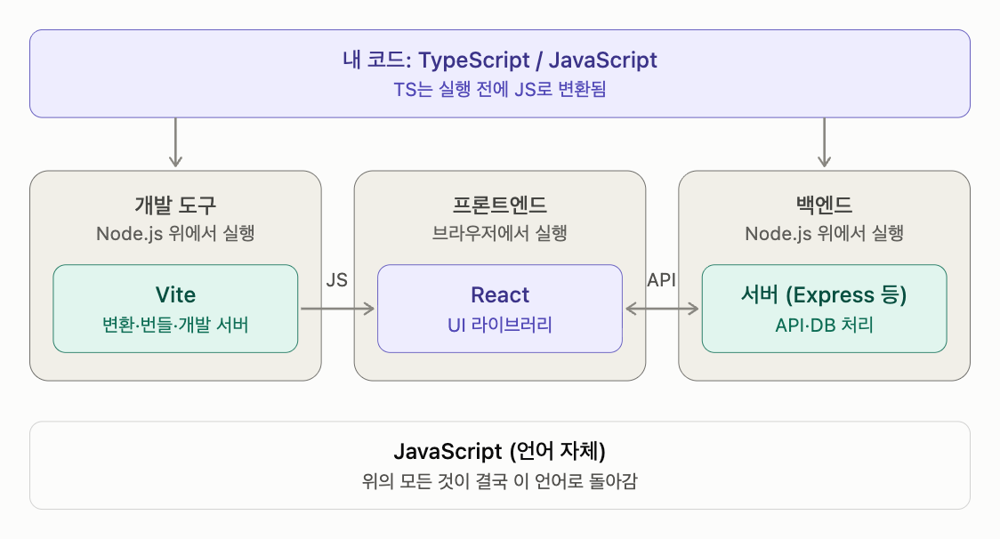

# 컴퓨터 언어

다른 이름: 프로그래밍 언어 · Programming languages · 컴파일과 런타임 · 개발 도구와 UI

주제: 컴퓨터 언어

프로그램을 표현하는 언어의 역사, 타입·메모리·동시성 설계와 실행 환경·개발 도구를 함께 다룬다.

## 내 정리

### JavaScript 생태계 한눈에 보기: 언어, 런타임, 라이브러리, 빌드 도구

**각 요소의 정체와 영역**

| 이름 | 정체 | 영역 |
| --- | --- | --- |
| JavaScript | 언어 | 프론트 + 백엔드 공통 |
| TypeScript | JS에 타입을 얹은 언어 (슈퍼셋) | 프론트 + 백엔드 공통 |
| Node.js | 브라우저 밖에서 JS를 실행하는 런타임 | 백엔드, 개발 도구 실행 |
| React | UI를 만드는 JS 라이브러리 | 프론트엔드 |
| Vite | 빌드 도구 겸 개발 서버 | 프론트엔드 개발 도구 |

**핵심 포인트**

-   JS는 원래 브라우저 안에서만 돌던 언어였음. Node.js가 등장하면서 PC나 서버에서도 돌게 됐고, 그 덕에 프론트와 백엔드를 JS/TS 한 언어로 다 짤 수 있게 됨. JS 생태계가 커진 큰 이유가 이것.
-   TS는 브라우저도 Node.js도 직접 실행하지 못함. 반드시 JS로 변환한 뒤에 실행됨.
-   Node.js는 쓰임이 두 가지임. 백엔드 서버를 돌리는 게 본업이고, 프론트엔드 쪽에서는 Vite 같은 개발 도구를 돌리는 용도로 빌려 씀.
-   React 프론트엔드에 Node.js가 필요한 건 개발·빌드 단계뿐임. 빌드 결과물은 정적 파일이라 배포할 때는 Node.js 없이 아무 웹서버에 올려도 됨.

**실행 흐름**

-   프론트엔드: TS + React 코드 작성 → Node.js 위에서 Vite가 JS로 변환·번들 → 브라우저가 받아서 React 앱 실행
-   백엔드: TS/JS로 서버 코드 작성 → Node.js가 직접 실행 → 프론트엔드의 API 요청을 처리

**익숙한 개념으로 비유하면**

JS/TS는 언어, Node.js는 `python` 인터프리터, React는 PyTorch 같은 라이브러리, Vite는 빌드 스크립트 겸 로컬 서버에 해당함.

## 용어

### 정적 타입 검사

실행 전에 타입 간 연산과 호출의 적합성을 검사한다. 보장 범위와 우회 수단은 언어별로 다르다.

### 프로그래밍 언어

계산과 데이터 처리를 규칙에 따라 표현하는 언어다. 실행 환경·프레임워크·패키지 관리자와 구분한다.

### 컴파일 시점

소스를 분석·변환하고 오류를 검사하는 단계다.

### 런타임

프로그램 실행 단계 또는 그 실행을 지원하는 코드·환경을 뜻한다.

### 네이티브 실행 파일

특정 OS·CPU 환경에서 직접 실행할 기계어 중심의 파일이다.

### JIT

실행 중 코드를 기계어로 컴파일하거나 최적화하는 방식이다.

### ABI

기계어 수준 호출 규약과 자료 배치 등 바이너리 간 호환 규칙이다.

### CLI

명령줄에서 인자·입출력으로 조작하는 인터페이스다.

### TUI

터미널의 문자 셀과 입력 이벤트로 구성하는 대화형 화면 인터페이스다.

### 렌더러

UI 표현을 DOM이나 터미널 셀 같은 실제 출력 대상으로 반영하는 구성 요소다.

### 컴파일과 런타임

소스 코드가 실행되는 과정과 컴파일러·실행 환경의 책임을 구분한다.

### 개발 도구와 UI

언어·화면 도구·실행 환경·배포 경로를 분리해 개발 도구의 구조를 이해한다.

## 컴퓨터 언어 · 역할과 핵심 개념

기록일: 2026-11-01T09:54:21.939Z

## 언어를 비교하는 기준
언어의 주 사용 분야와 실행 방식은 별개의 축이다. TypeScript는 웹과 서버, Go는 서버·인프라, Rust는 시스템과 성능이 중요한 영역에 많이 쓰이지만 사용 범위가 고정되어 있지는 않다.

- **타입 체계**: 오류를 언제 검사하고, 어떤 관계를 호환되는 타입으로 인정하는가.
- **메모리 관리**: 개발자·컴파일러·런타임 중 누가 메모리 수명을 관리하는가.
- **동시성**: 여러 작업의 실행과 공유 상태를 어떤 추상화로 다루는가.
- **실행·배포**: JavaScript 실행 환경이나 JVM이 필요한지, 플랫폼별 네이티브 실행 파일을 만드는지 구분한다.
- **도구와 생태계**: 빌드·패키지·디버깅 도구, 기존 코드와의 호환성도 선택에 영향을 준다.

Rust·TypeScript·Go는 모두 기존 언어로 대규모 소프트웨어를 개발하면서 겪은 문제에서 출발했다. Rust는 메모리 안전성, TypeScript는 JavaScript의 정적 분석, Go는 단순한 언어와 빠른 개발·배포를 중심에 둔다.

## 컴파일과 런타임 · 역할과 핵심 개념

기록일: 2026-11-01T09:54:44.841Z

## 실행까지의 경로
- **TypeScript**: 타입 검사 및 JavaScript 출력 → 브라우저·Node.js 등의 JavaScript 엔진에서 실행한다. 지원 문법을 직접 제거하는 호스트도 있다.
- **Rust**: 주로 대상 OS·CPU의 네이티브 실행 파일로 컴파일한다. 별도의 Node.js나 JVM은 필요하지 않지만 OS·ABI·공유 라이브러리 등의 조건은 남는다.
- **Go**: 네이티브 실행 파일을 만들며 GC·스케줄러 같은 Go 런타임을 포함한다.
- **Java**: 보통 바이트코드와 JVM을 사용한다. AOT 네이티브 배포도 가능하다.

컴파일 언어와 런타임 유무를 같은 축으로 보지 않는다. 컴파일된 프로그램에도 실행 지원 코드가 존재할 수 있다. 설치 도구와 실행 환경도 구분해야 한다. npm으로 배포했다고 프로그램 본체가 JavaScript라는 뜻은 아니다.
